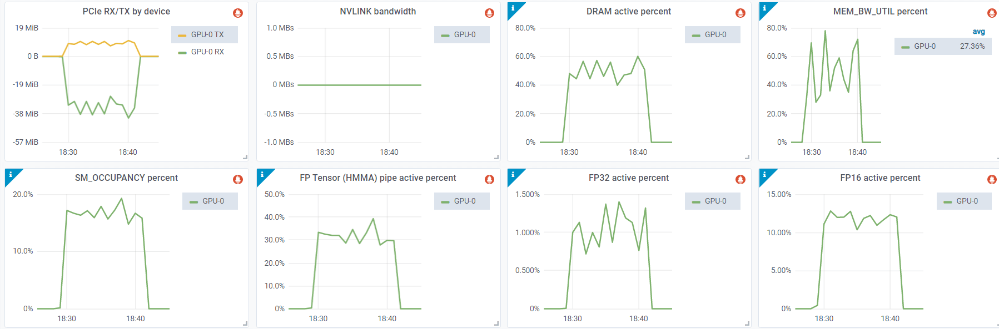

# Troubleshooting NVIDIA GPUs

## Glossary

- DBE: Double Bit ECC Error
- DCGM: (NVIDIA) Data Center GPU Manager
- ECC: Error-Correcting Code
- FB: Frame Buffer
- SBE: Single Bit ECC Error
- SDC: Silent Data Corruption

## Errors and diagnostics

See also [Diagnosing crashes, hangs and tracing execution](../../../debug/pytorch.md#diagnosing-crashes-hangs-and-tracing-execution) for diagnosing crashes from the software side.

### Xid Errors

No hardware is perfect, sometimes due to the manufacturing problems or due to tear and wear (especially because of exposure to high heat), GPUs are likely to encounter various hardware issues. A lot of these issues get corrected automatically without needing to really understand what's going on. If the application continues running usually there is nothing to worry about. If the application crashes due to a hardware issue it's important to understand why this is so and how to act on it.

A normal user who uses a handful of GPUs is likely to never need to understand GPU-related hardware issues, but if you come anywhere close to massive ML training where you are likely to use hundreds to thousands of GPUs it's certain that you'd want to understand about different hardware issues.

In your system logs you are likely to see occasionally Xid Errors like:

```
NVRM: Xid (PCI:0000:10:1c): 63, pid=1896, Row Remapper: New row marked for remapping, reset gpu to activate.
```

To get those logs one of the following ways should work:
```bash
sudo grep Xid /var/log/syslog
sudo dmesg -T | grep Xid
```

Typically, as long as the training doesn't crash, these errors often indicate issues that automatically get corrected by the hardware.

The full list of Xid Errors and their interpretation can be found [here](https://docs.nvidia.com/deploy/xid-errors/latest/index.html).

Many Xid log lines carry far more fields than the one above, and they are cryptic. [Xid 31 MMU Faults: What Causes Them and How to Fix Production GPU Crashes](https://www.abhik.ai/articles/gpu-xid31-mmu-faults) is a good example of how to decipher one: it decodes every field of an Xid 31 line from `dmesg` - the faulting engine and hardware unit, the virtual address, `FAULT_PDE` vs `FAULT_PTE` and the access type - and follows them to the cause, a use-after-free between the PyTorch, CuPy and NVDEC memory allocators. It also shows that not every Xid is a hardware problem - this one was caused by software.

NVIDIA's [Xid Catalog](https://docs.nvidia.com/deploy/xid-errors/analyzing-xid-catalog.html) goes further for Ampere and newer GPUs: for each Xid it lists which GPUs can log it, what triggers it, and what to do about it - an immediate action, such as `RESTART_APP` or `CONTACT_SUPPORT`, and a follow-up one, such as `CHECK_APP/CUDA`. It can be downloaded as a spreadsheet, which helps when mapping the Xids in your logs to actions automatically. For Xid 13 and 31, which it says are typically bugs in the application, its first recommendation is Compute Sanitizer's `memcheck` - see [Debugging CUDA kernel memory errors with `compute-sanitizer`](../../../debug/pytorch.md#debugging-cuda-kernel-memory-errors-with-compute-sanitizer) for how to run it on a PyTorch program.

You can run `nvidia-smi -q` and see if there are any error counts reported. For example, in this case of Xid 63, you will see something like:

```
Timestamp                                 : Wed Jun  7 19:32:16 2023
Driver Version                            : 510.73.08
CUDA Version                              : 11.6

Attached GPUs                             : 8
GPU 00000000:10:1C.0
    Product Name                          : NVIDIA A100-SXM4-80GB
    [...]
    ECC Errors
        Volatile
            SRAM Correctable              : 0
            SRAM Uncorrectable            : 0
            DRAM Correctable              : 177
            DRAM Uncorrectable            : 0
        Aggregate
            SRAM Correctable              : 0
            SRAM Uncorrectable            : 0
            DRAM Correctable              : 177
            DRAM Uncorrectable            : 0
    Retired Pages
        Single Bit ECC                    : N/A
        Double Bit ECC                    : N/A
        Pending Page Blacklist            : N/A
    Remapped Rows
        Correctable Error                 : 1
        Uncorrectable Error               : 0
        Pending                           : Yes
        Remapping Failure Occurred        : No
        Bank Remap Availability Histogram
            Max                           : 639 bank(s)
            High                          : 1 bank(s)
            Partial                       : 0 bank(s)
            Low                           : 0 bank(s)
            None                          : 0 bank(s)
[...]
```

Here we can see that Xid 63 corresponds to:

```
ECC page retirement or row remapping recording event
```

which may have 3 causes: HW Error / Driver Error / FrameBuffer (FB) Corruption

This error means that one of the memory rows is malfunctioning and that upon either reboot and/or a gpu reset one of the 640 spare memory rows (in A100) will be used to replace the bad row. Therefore we see in the report above that only 639 banks remain (out of 640).

The Volatile section of the `ECC Errors` report above refers to the errors recorded since last reboot/GPU reset. The Aggregate section records the same error since the GPU was first used.

Now, there are 2 types of errors - Correctable and Uncorrectable. The correctable one is a Single Bit ECC Error (SBE) where despite memory being faulty the driver can still recover the correct value. The uncorrectable one is where more than one bit is faulty and it's called Double Bit ECC Error (DBE). Typically, the driver will retire whole memory pages if 1 DBE or 2 SBE errors occur at the same memory address. For full information see [this document](https://docs.nvidia.com/deploy/dynamic-page-retirement/index.html)

A correctable error will not impact the application, a non-correctable one will crash the application. The memory page containing the uncorrectable ECC error will be blacklisted and not accessible until the GPU is reset.

If there are page scheduled to be retired you will see something like this in the output of `nvidia-smi -q`:

```
    Retired pages
        Single Bit ECC             : 2
        Double Bit ECC             : 0
        Pending Page Blacklist    : Yes
```

Each retired page decreases the total memory available to applications. But the maximum amount of pages retired amounts to only 4MiB in total, so it doesn't reduce the total available GPU memory by much.

To dive even deeper into the GPU debugging, please refer to [this document](https://docs.nvidia.com/deploy/gpu-debug-guidelines/index.html) - it includes a useful triage chart which helps to determine when to RMA GPUs. This document has additional information about Xid 63-like errors

For example it suggests:

> If associated with XID 94, the application that encountered the error needs to be restarted. All other applications on the system can keep running as is until there is a convenient time to reboot for row remapping to activate.

If after a reboot the same condition occurs for the same memory address, memory remapping has failed and Xid 64 is emitted. If it keeps happening after reboot, the GPU needs to be RMA'ed.

When that happens it shows up in the same `Remapped Rows` block as above, with the failure flag set and a bank that has run out of spares. This is [Crusoe Cloud's published signature](https://docs.crusoecloud.com/resources/troubleshooting) for a GPU that qualifies for replacement:

```
Remapped Rows
        Correctable Error                 : 0
        Uncorrectable Error               : 0
        Pending                           : No
        Remapping Failure Occurred        : Yes
        Bank Remap Availability Histogram
            Max                           : 639 bank(s)
            High                          : 0 bank(s)
            Partial                       : 0 bank(s)
            Low                           : 0 bank(s)
            None                          : 1 bank(s)
```

Note that not a single row was remapped successfully, yet a failure has been recorded, and one bank sits at `None` - it has no reserved rows left to remap into. That combination is what distinguishes a GPU that needs replacing from one that just needs a reset. To read only this block rather than the whole report, use `nvidia-smi -q -d ROW_REMAPPER`.

At other times you may get Xid 63 or 64 and the application will crash, which usually generates additional Xid errors, but most of the time it means that the error was uncorrectable (i.e. it was a DBE sort of an error and then it'll be Xid 48).

As mentioned earlier to reset a GPU you can either simply reboot the machine, or run:

```bash
nvidia-smi -r -i gpu_id
```

where `gpu_id` is the sequential number of the gpu you want to reset, e.g. `0` for the first GPU. Without `-i` all GPUs will be reset.

#### uncorrectable ECC error encountered

If you get an error:
```
CUDA error: uncorrectable ECC error encountered
```
as in the previous section, checking the output of `nvidia-smi -q` this time for `ECC Errors` entries will tell which GPU is the problematic one. But if you need to do a quick check in order to recycle a node if it has at least one GPU with this issue, you can just do this:

```bash
$ nvidia-smi -q | grep -i correctable | grep -v 0
            SRAM Uncorrectable            : 1
            SRAM Uncorrectable            : 5
```
On a good node, this should return nothing, as all counters should be 0. But in the example above we had one broken GPU - there were two entries because the full record was:

```
    ECC Errors
        Volatile
            SRAM Correctable              : 0
            SRAM Uncorrectable            : 1
            DRAM Correctable              : 0
            DRAM Uncorrectable            : 0
        Aggregate
            SRAM Correctable              : 0
            SRAM Uncorrectable            : 5
            DRAM Correctable              : 0
            DRAM Uncorrectable            : 0
```
The first entry is for `Volatile` (errors counted since the last time the GPU driver reload) and the second is for `Aggregate` (total errors counter for the whole life time of the GPU). In this example we see a Volatile counter for SRAM Uncorrectable errors to be 1 and for the life-time counter it's 5 - that is this is not the first time the GPU runs into this problem.

This typically would correspond to Xid 94 error (see: [Xid Errors](#xid-errors), most likely w/o Xid 48).

To overcome this issue as in the previous section, reset the problematic GPU:
```bash
nvidia-smi -r -i gpu_id
```
Rebooting the machine will have the same effect.

Now when it comes to Aggregate SRAM Uncorrectable errors, if you have more than 4, that's usually a reason to RMA that GPU.


### Running diagnostics

If you suspect one or more NVIDIA GPUs are broken on a given node, `dcgmi` is a great tool to quickly find any bad GPUs.

NVIDIA® Data Center GPU Manager (DCGM) is documented [here](https://docs.nvidia.com/datacenter/dcgm/latest/user-guide/index.html) and can be downloaded from [here](https://github.com/NVIDIA/DCGM#quickstart).

Here is an example slurm script that will run very in-depth diagnostics (`-r 3`), which will take about 10 minutes to complete on an 8-GPU node:

```bash
$ cat dcgmi-1n.slurm
#!/bin/bash
#SBATCH --job-name=dcgmi-1n
#SBATCH --nodes=1
#SBATCH --ntasks-per-node=1
#SBATCH --cpus-per-task=96
#SBATCH --gres=gpu:8
#SBATCH --exclusive
#SBATCH --output=%x-%j.out

set -x -e
echo "START TIME: $(date)"
srun --cpus-per-task=$SLURM_CPUS_PER_TASK --output=%x-%j-%N.out dcgmi diag -r 3
echo "END TIME: $(date)"
```

Now to run it on specific nodes of choice:
```bash
sbatch --nodelist=node-115 dcgmi-1n.slurm
sbatch --nodelist=node-151 dcgmi-1n.slurm
sbatch --nodelist=node-170 dcgmi-1n.slurm
```
edit the nodelist argument to point to the node name to run.

If the node is drained or downed and you can't launch a slurm job using this node, just `ssh` into the node and run the command directly on the node:
```bash
dcgmi diag -r 3
```
If the diagnostics didn't find any issue, but the application still fails to work, re-run the diagnostics with level 4, which will now take more than 1 hour to complete:
```bash
dcgmi diag -r 4
```

footnote: apparently silent data corruptions (SDC) can only be detected with `dcgmi diag -r 4` and even then some might be missed. This problem happens occasionally and you may not even be aware that your GPU is messing up the `matmul` at times. I'm pretty sure we had this happen to us, as we were getting weird glitches during training and I spent many days with the NVIDIA team diagnosing the problem, but we failed to do so - eventually the problem disappeared probably because the bad GPU(s) got replaced due to reported failures.

For example, if you run into a repeating Xid 64 error it's likely that the diagnostics report will include:

```
+---------------------------+------------------------------------------------+
| Diagnostic                | Result                                         |
+===========================+================================================+
|-----  Deployment  --------+------------------------------------------------|
| Error                     | GPU 3 has uncorrectable memory errors and row  |
|                           |  remappings are pending                        |
```

so you now know to RMA that problematic GPU, if remapping fails.

But, actually, I found that most of the time `-r 2` already detects faulty GPUs. And it takes just a few minutes to complete. Here is an example of the `-r 2` output on a faulty node:

```
| GPU Memory                | Pass - GPUs: 1, 2, 3, 4, 5, 6, 7               |
|                           | Fail - GPU: 0                                  |
| Warning                   | GPU 0 Thermal violations totaling 13.3 second  |
|                           | s started at 9.7 seconds into the test for GP  |
|                           | U 0 Verify that the cooling on this machine i  |
|                           | s functional, including external, thermal mat  |
|                           | erial interface, fans, and any other componen  |
|                           | ts.
```

The `dcgmi` tool contains various other levels of diagnostics, some of which complete in a matter of a few minutes and can be run as a quick diagnostic in the epilogue of SLURM jobs to ensure that the node is ready to work for the next SLURM job, rather than discovering that after the user started their job and it crashed.

When filing an RMA report you will be asked to run `nvidia-bug-report.sh` script, the output of which you will need to submit with the RMA request.

I usually save the log as well for posterity using one of:
```bash
dcgmi diag -r 2 | tee -a dcgmi-r2-`hostname`.txt
dcgmi diag -r 3 | tee -a dcgmi-r3-`hostname`.txt
dcgmi diag -r 4 | tee -a dcgmi-r4-`hostname`.txt
```

## Health and inventory checks

### How to get the VBIOS info

GPU VBIOS version might be important when researching issues. Let's add the name and bus id to the query, we get:

```bash
$ nvidia-smi --query-gpu=gpu_name,gpu_bus_id,vbios_version --format=csv
name, pci.bus_id, vbios_version
NVIDIA H100 80GB HBM3, 00000000:04:00.0, 96.00.89.00.01
[...]
NVIDIA H100 80GB HBM3, 00000000:8B:00.0, 96.00.89.00.01
```

Hint: to query for dozens of other things, run:
```bash
nvidia-smi --help-query-gpu
```

### How to check if your GPU's PCIe generation is supported

Check the PCIe bandwidth reports from the system's boot messages:

```bash
$ sudo dmesg | grep -i 'limited by'
[   10.735323] pci 0000:04:00.0: 252.048 Gb/s available PCIe bandwidth, limited by 16.0 GT/s PCIe x16 link at 0000:01:00.0 (capable of 504.112 Gb/s with 32.0 GT/s PCIe x16 link)
[...]
[   13.301989] pci 0000:8b:00.0: 252.048 Gb/s available PCIe bandwidth, limited by 16.0 GT/s PCIe x16 link at 0000:87:00.0 (capable of 504.112 Gb/s with 32.0 GT/s PCIe x16 link)
```

In this example, as PCIe 5 spec is 504Gbps, you can see that on this node only half of the possible bandwidth is usable, because the PCIe switch is gen4. For PCIe specs see [this](../../../network/README.md#pcie).

Since most likely you have [NVLink](../../../network/README.md#nvlink) connecting the GPUs to each other, this shouldn't matter for GPU to GPU comms, but it'd slow down any data movement between the GPU and the host, as the data speed is limited by the speed of the slowest link.


### How to check error counters of NVLink links

If you're concerned your NVLink malfunctions you can check its error counters:
```bash
$ nvidia-smi nvlink -e
GPU 0: NVIDIA H100 80GB HBM3 (UUID: GPU-abcdefab-cdef-abdc-abcd-abababababab)
         Link 0: Replay Errors: 0
         Link 0: Recovery Errors: 0
         Link 0: CRC Errors: 0

         Link 1: Replay Errors: 0
         Link 1: Recovery Errors: 0
         Link 1: CRC Errors: 0

         [...]

         Link 17: Replay Errors: 0
         Link 17: Recovery Errors: 0
         Link 17: CRC Errors: 0
```

Another useful command is:
```bash
$ nvidia-smi nvlink --status
GPU 0: NVIDIA H100 80GB HBM3 (UUID: GPU-abcdefab-cdef-abdc-abcd-abababababab)
         Link 0: 26.562 GB/s
         [...]
         Link 17: 26.562 GB/s
```
this one tells you the current speed of each link

Run `nvidia-smi nvlink -h` to discover more features (reporting, resetting counters, etc.).


### How to check GPU memory row-remapping health

Row remapping is how Ampere and later GPUs deal with memory that has gone bad - a degrading bank row is replaced by one of the spares that every HBM bank reserves for the purpose. It is [NVIDIA's replacement for the page retirement scheme](https://docs.nvidia.com/deploy/a100-gpu-mem-error-mgmt/latest/row-remapping.html) used by earlier generations, with a much larger budget: up to 512 remappings for the frame buffer, against 64 retirements before it. [Xid Errors](#xid-errors) covers what this looks like once a GPU has thrown an Xid 63 or 64 - this section is about checking it deliberately, before a job dies.

That section reads the state out of `nvidia-smi -q`, which prints a long block per GPU. For checking a whole node there is a CSV query that gives one line per GPU instead:

```bash
$ nvidia-smi --query-remapped-rows=gpu_name,gpu_bus_id,remapped_rows.failure,remapped_rows.pending,remapped_rows.correctable,remapped_rows.uncorrectable --format=csv
gpu_name, gpu_bus_id, remapped_rows.failure, remapped_rows.pending, remapped_rows.correctable, remapped_rows.uncorrectable
NVIDIA H200, 00000000:59:00.0, No, No, 0, 0
[...]
NVIDIA H200, 00000000:A5:00.0, No, No, 0, 0
```

That is a healthy node - no failures, nothing pending, no rows remapped. To see the other end of it, [Xid Errors](#xid-errors) shows the same fields from a GPU whose row remapping has failed. Reading a report that isn't all `No` and `0`:

- `correctable` and `uncorrectable` count the rows that have already been remapped, after repeated SBEs and after a DBE respectively. A non-zero count is not by itself a reason to pull the GPU out of service - it means the sparing did its job.
- `pending: Yes` means a remap has been decided but doesn't take effect until the GPU is reset, and it does not put the running job at risk of touching the bad cell. It does change how much memory that GPU has, though: when the trigger was an uncorrectable error the driver offlines the page containing it immediately, and that page stays out of the allocatable pool until the reset remaps the row in hardware and hands the address space back - so a job sized to fill HBM can start hitting OOM on this GPU while still fitting on a healthy one.
- `failure: Yes` means a remap was attempted and did not succeed. This is the one that means RMA rather than reset-and-return.

The same fields are available from `--query-gpu` if you want them alongside other per-GPU columns, e.g. `nvidia-smi --query-gpu=gpu_bus_id,remapped_rows.pending,remapped_rows.failure --format=csv`.

Hint: for the full field list, including the `remapped_rows.sbe`/`.dbe` aliases, run:
```bash
nvidia-smi --help-query-remapped-rows
```


### How to detect if a node is missing GPUs

If you got a new VM, there are odd cases where there is less than expected number of GPUs. Here is how you can quickly test you have got 8 of them:

```bash
cat << 'EOT' >> test-gpu-count.sh
#!/bin/bash

set -e

# test the node has 8 gpus
test $(nvidia-smi -q | grep UUID | wc -l) != 8 && echo "broken node: not exactly 8 gpus" && false
EOT
```
and then:

```bash
bash test-gpu-count.sh
```


### How to detect if you get the same broken node again and again

This is mostly relevant to cloud users who rent GPU nodes.

So you launched a new virtual machine and discovered it has one or more broken NVIDIA GPUs. You discarded it and launched a new and the GPUs are broken again.

Chances are that you're getting the same node with the same broken GPUs. Here is how you can know that.

Before discarding the current node, run and log:

```bash
$ nvidia-smi -q | grep UUID
    GPU UUID                              : GPU-2b416d09-4537-ecc1-54fd-c6c83a764be9
    GPU UUID                              : GPU-0309d0d1-8620-43a3-83d2-95074e75ec9e
    GPU UUID                              : GPU-4fa60d47-b408-6119-cf63-a1f12c6f7673
    GPU UUID                              : GPU-fc069a82-26d4-4b9b-d826-018bc040c5a2
    GPU UUID                              : GPU-187e8e75-34d1-f8c7-1708-4feb35482ae0
    GPU UUID                              : GPU-43bfd251-aad8-6e5e-ee31-308e4292bef3
    GPU UUID                              : GPU-213fa750-652a-6cf6-5295-26b38cb139fb
    GPU UUID                              : GPU-52c408aa-3982-baa3-f83d-27d047dd7653
```

These UUIDs are unique to each GPU.

When you then re-created your VM, run this command again - if the UUIDs are the same - you know you have the same broken GPUs.

To automate this process so that you always have this data as it'd be too late if you already rebooted the VM, add somewhere in your startup process this:

```bash
nvidia-smi -q | grep UUID > nvidia-uuids.$(hostname).$(date '+%Y-%m-%d-%H:%M').txt
```

You'd want to save the log file on some persistent filesystem for it to survive reboot. If you do not have one make it local and immediately copy to the cloud. That way it'll always be there when you need it.

Sometimes just rebooting the node will get new hardware. In some situations you get new hardware on almost every reboot, in other situations this doesn't happen. And this behavior may change from one provider to another.

If you keep on getting the same broken node - one trick to overcoming this is allocating a new VM, while holding the broken VM running and when the new VM is running - discarding the broken one. That way you will surely get new GPUs - except there is no guarantee they won't be broken as well. If the use case fits consider getting a static cluster where it's much easier to keep the good hardware.

This method is extra-crucial for when GPUs don't fail right away but after some use so it is non-trivial to see that there is a problem. Even if you reported this node to the cloud provider the technician may not notice the problem right away and put the bad node back into circulation. So if you're not using a static cluster and tend to get random VMs on demand you may want to keep a log of bad UUIDs and know you have got a lemon immediately and not 10 hours into the node's use.

Cloud providers usually have a mechanism of reporting bad nodes. Therefore other than discarding a bad node, it'd help yourself and other users to report bad nodes. Since most of the time users just discard the bad nodes, the next user is going to get them. I have seen users getting a very high percentage of bad nodes in some situations.


### How to find a straggler GPU

A straggler is a GPU that works correctly but slower than its peers. It throws no Xid errors, its health counters read clean, and nothing crashes, yet in any job that runs its GPUs in lockstep - training, or inference with tensor, expert or pipeline parallelism - every GPU waits for the slowest one at each collective, so the whole job runs at the slow GPU's pace. In the case below, one such GPU made the compute part of every step of a 32-GPU job 3-4% slower.

[gpu-straggler-finder.py](../benchmarks/gpu-straggler-finder.py) finds them in one run. It runs the benchmark's training step on every GPU at once, with no communication between them, for 60 seconds, then a matmul, a memory copy and a memory-bound kernel for 30 seconds each, logging each GPU's clock, power, temperature and clock-limit reasons throughout. It cuts each workload into 2-second windows, compares each GPU with its node's median GPU in the same window and each node's median GPU with the median node's, and judges each by its 90th percentile window, the one only a tenth of its windows are slower than. It flags a GPU as slow when that window in any workload is an outlier among all the GPUs - a [modified z-score](https://www.itl.nist.gov/div898/handbook/eda/section3/eda35h.htm) above 3.5 - and more than 1% slower than its node's median GPU, as unsteady when that window is more than 1.25% slower than its own median window and an outlier too, and a node as slow when its median GPU's is more than 3% slower than the median node's, and lists each with the identifiers to report it by. To run it:

```bash
python gpu-straggler-finder.py  # all the GPUs of one node
torchrun --nnodes 4 --nproc_per_node 8 --rdzv_backend c10d \
    --rdzv_endpoint $MASTER_ADDR:29500 gpu-straggler-finder.py
```

Run it on GPUs that have been idle for a minute or two - the whole run takes about 3 minutes. A GPU that is slow only some of the time can pass a single run, so if the first run flags anything, run it 3 more times with `--repeat 3`, 2 minutes idle apart, which took 12 minutes on 4 nodes, and take a GPU flagged in all 4 runs to be a straggler. [Straggler finder](../benchmarks/README.md#straggler-finder) has its other settings.

Here is its report on 4 nodes of 8x B200, one of them the node of the straggler in [How one straggler was found](#how-one-straggler-was-found), on GPUs that had been idle for a minute:

```
measuring 32 GPUs at once: the training step for 60s, then a matmul, a memory copy and a memory stream for 30s each - about 2m50s in all

setup: allocating and filling the buffers ...
setup: allocating and filling the buffers: done in 12.8s
gathering the results ...
gathering the results: done in 0.4s

32 GPUs (NVIDIA B200), 4 node(s)
step: 32x decoder layer h=4096 ffn=14336 heads=32/8, 1x8192 tokens, bf16, forward+backward, 100ms idle after each step - median 404.85ms, fastest 399.34ms, slowest 411.96ms, spread 3.2%, median absolute deviation 2.22ms
matmul: 8192x8192x8192 bf16 back to back for 30s - median 1315 TFLOPS, slowest 1264, fastest 1343, spread 6.2%
copy: a 1024MiB cudaMemcpy within each GPU's memory for 30s - median 6444 GB/s read+written, slowest 6398, fastest 6494, spread 1.5%
stream: c = a + b on 1024MiB buffers, on the SMs, for 30s - median 6966 GB/s read+written, slowest 6920, fastest 7006, spread 1.2%
each node's median GPU vs the median node's in the same 2s window, + is slower: the median window / the 90th percentile window

node                   step        matmul          copy        stream
cluster-a-3     +0.6/ +0.9%   +1.3/ +1.4%   +0.2/ +0.2%   +0.2/ +0.2%
cluster-a-0     +0.1/ +0.2%   +0.2/ +0.3%   -0.1/ -0.1%   +0.0/ +0.0%
cluster-a-1     -0.2/ -0.1%   -0.8/ -0.6%   +0.1/ +0.1%   -0.0/ +0.0%
cluster-a-2     -0.3/ -0.1%   -0.2/ -0.1%   -0.1/ -0.1%   -0.1/ -0.1%

each workload in 2s windows, each GPU's time vs its node's median GPU's in the same window, + is slower: the median window / the 90th percentile window

node           GPU   step ms          step        matmul          copy        stream  step MHz  matmul MHz  power W  max C  power-capped  other limits
cluster-a-3      3    411.96   +1.0/ +3.4%   +3.2/ +3.4%   -0.3/ -0.3%   -0.1/ -0.1%      1560        1065      889     61          100%    <-- straggler: step unsteady
cluster-a-1      4    407.85   +1.1/ +1.4%   +2.2/ +2.7%   +0.5/ +0.6%   +0.5/ +0.5%      1567        1102      894     66          100%
cluster-a-2      2    406.95   +0.9/ +1.3%   +0.3/ +0.8%   +0.6/ +0.6%   +0.5/ +0.5%      1582        1192      894     69          100%
cluster-a-2      6    405.86   +0.7/ +1.1%   +0.3/ +0.5%   +0.6/ +0.6%   +0.5/ +0.5%      1582        1170      895     71          100%
cluster-a-0      3    407.33   +0.6/ +1.1%   +1.0/ +1.3%   -0.1/ -0.1%   -0.0/ -0.0%      1575        1140      890     60          100%
cluster-a-2      0    405.97   +0.7/ +1.1%   -0.3/ -0.1%   +0.6/ +0.6%   +0.5/ +0.5%      1590        1162      892     70          100%
cluster-a-1      6    406.56   +0.6/ +1.0%   +0.9/ +1.2%   +0.6/ +0.6%   +0.6/ +0.7%      1590        1185      896     69          100%
cluster-a-0      0    406.52   +0.4/ +0.9%   +0.7/ +0.9%   +0.7/ +0.7%   +0.6/ +0.6%      1590        1102      895     71          100%
cluster-a-0      1    404.06   -0.2/ +0.1%   +3.1/ +3.2%   -0.5/ -0.5%   -0.5/ -0.5%      1612        1080      885     60          100%
cluster-a-0      4    404.02   -0.2/ -0.0%   -0.8/ -0.3%   +0.1/ +0.3%   +0.0/ +0.0%      1597        1185      895     67          100%
cluster-a-2      5    400.18   -0.8/ -0.2%   -0.4/ -0.1%   -0.4/ -0.4%   -0.4/ -0.4%      1597        1140      888     61          100%
cluster-a-0      5    399.34   -1.3/ -1.0%   -1.1/ -0.4%   -0.9/ -0.8%   -0.5/ -0.5%      1620        1177      890     58          100%
... and 20 more GPUs, step -0.7 to +1.0% in their 90th percentile windows (--unflagged_rows -1 prints them)

1 straggler(s) - report them by UUID and serial, which don't change with the node name or the GPU's index:
  cluster-a-3 GPU 3: unsteady in step: its 90th percentile window 2.3% slower than its median one (z 17.6) - uuid GPU-00000000-1111-2222-3333-444444444444, serial 1650000000001, pci 00000000:63:00.0
a straggler is any of
  slow: a 90th percentile window above a modified z-score of 3.5 among the GPUs measured, and more than 1% slower than its node's median GPU (--outlier, --threshold)
  unsteady: a 90th percentile window more than 1.25% slower than its own median window, above a modified z-score of 3.5 among the GPUs measured (--unsteady)
  slow node: its median GPU's 90th percentile window more than 3% slower than the median node's (--slow_node)

runtimes:
  setup: allocating and filling the buffers     12.8s
  step                                          1m27s
  matmul                                        30.3s
  copy                                          30.0s
  stream                                        30.0s
  gathering the results                          0.4s
  report                                         0.3s
  total                                         3m13s
```

GPU 3 of `cluster-a-3` is flagged as unsteady: its step's 90th percentile window was 3.4% slower than its node's median GPU, while its median window was 1.0% slower, and no other GPU's 90th percentile step window was more than 1.4% slower. Its matmul ran 3.2-3.4% slower too, but so did that of `cluster-a-0` GPU 1, 3.1-3.2%, whose step ran at full speed, so the matmul alone couldn't tell the straggler from a healthy GPU.

On 4 healthy nodes, `cluster-a-0` to `cluster-a-2` with `cluster-a-4` in place of `cluster-a-3`, its report ends instead with:

```
no straggler - per workload, the slowest 90th percentile window, and the largest gap between a GPU's 90th percentile and median windows:
  step: slowest cluster-a-4 GPU 7 +1.9% (z 2.1), least steady cluster-a-0 GPU 5 +0.5% (z 1.5), slowest node cluster-a-0 +0.7%
  matmul: slowest cluster-a-0 GPU 1 +3.4% (z 3.2), least steady cluster-a-4 GPU 3 +0.7% (z 2.4), slowest node cluster-a-0 +0.9%
  copy: slowest cluster-a-0 GPU 0 +0.8% (z 1.7), least steady cluster-a-0 GPU 5 +0.2% (z 9.6), slowest node cluster-a-1 +0.3%
  stream: slowest cluster-a-1 GPU 6 +0.7% (z 1.4), least steady cluster-a-4 GPU 2 +0.0% (z 4.8), slowest node cluster-a-1 +0.1%
a straggler is any of
  slow: a 90th percentile window above a modified z-score of 3.5 among the GPUs measured, and more than 1% slower than its node's median GPU (--outlier, --threshold)
  unsteady: a 90th percentile window more than 1.25% slower than its own median window, above a modified z-score of 3.5 among the GPUs measured (--unsteady)
  slow node: its median GPU's 90th percentile window more than 3% slower than the median node's (--slow_node)
```

The slowest matmul is again that of `cluster-a-0` GPU 1, 3.4% slower than its node's median GPU, at a modified z-score of 3.2, under the 3.5 that would flag it.

Once you have found it, record what identifies the GPU itself and not only its index - an index means something only together with the node, and node names get recycled:

```bash
nvidia-smi -i 3 --format=csv \
  --query-gpu=index,uuid,serial,pci.bus_id,vbios_version
```

Then exclude the node from your job and report the GPU to your provider with that UUID and serial, together with the per-GPU numbers - "this GPU is 5% slower at compute than its 31 peers on the same workload" is something a technician can check, while "my job is slow" is not. See [How to detect if you get the same broken node again and again](#how-to-detect-if-you-get-the-same-broken-node-again-and-again) for keeping track of UUIDs, so that you recognize the same GPU if it comes back to you.

Note: the GPU index that `nvidia-smi` prints counts from 0, and so does `CUDA_VISIBLE_DEVICES`, but the two orders are only the same if `CUDA_DEVICE_ORDER=PCI_BUS_ID` is set or the driver happens to enumerate them that way. Check by printing `torch.cuda.get_device_properties(i).uuid` from your program and comparing it with `nvidia-smi`'s UUID before you report a GPU by its index.

#### How one straggler was found

Here is how the straggler in the report above was found on a 4 8x B200 node job, while re-measuring [comm-compute-overlap-bench.py](../../../network/benchmarks/comm-compute-overlap-bench.py). The symptom was that the compute part of every step came out 12-18ms (3-4%) above what the same benchmark had measured on a different 4-node allocation two days earlier - e.g. the `ddp` step at 8192 tokens took 404.04ms against 390.53ms.

1. Rule out the network. The same benchmark also times the communication alone, and that matched the earlier allocation within 0.5% (140.77ms against 140.66ms). So the network wasn't slower - the GPUs were.

2. Run the same workload on each node alone, all the nodes at once. 3 nodes took 388.25-389.12ms and one took 403.94ms, which is the slowdown of the 4-node job - so a single node was setting the pace for all 4.

3. Run the same workload on each GPU alone, all the GPUs at once - 8 separate 1-GPU processes per node, on all the nodes, each with its own rendezvous port:

   ```bash
   for g in 0 1 2 3 4 5 6 7; do
     CUDA_VISIBLE_DEVICES=$g torchrun --nproc_per_node=1 \
       --rdzv_backend c10d --rdzv_endpoint localhost:$((9500+g)) \
       comm-compute-overlap-bench.py --pattern ddp --layers 32 \
       --tokens 8192 --num_iterations 20 \
       >> console-$(hostname)-gpu$g.txt 2>&1 &
   done
   wait
   ```

   The 31 healthy GPUs took 379.26-390.10ms (median 384.52ms) and GPU 3 of the slow node took 404.14ms - 5.1% above the median and 3.6% above the next slowest GPU. That gap is larger than the whole 2.9% spread of the other 31.

4. Confirm it in a profiler trace of the multi-GPU job. In the [Nsight Systems](https://developer.nvidia.com/nsight-systems) (`nsys`) trace of the slow node, GPU 3 ran the very same kernels longer than the node's other 7 GPUs: the matmuls by 3.5-9%, flash attention by 4.2%, the reductions by 4.7% and the copies by 3.1%. The slowdown is spread over compute-bound and memory-bound kernels alike, which points at the GPU rather than at any one kernel, while its device-to-device memcpys, limited by the HBM bandwidth, ran within 2% of the other GPUs' - so the SMs were slow, not the memory.

Running everything at once matters for two reasons. The GPUs share the node's power, cooling and PCIe switches, and a GPU that is fast when it runs alone can be slow when its neighbors are busy - which is how it is used in training. And measuring 32 GPUs one after another takes 32 times longer while the conditions drift between the runs.

Use a workload that looks like your training step rather than a single matmul. [mamf-finder](../benchmarks/README.md#maximum-achievable-and-sustainable-matmul-flops-finder) ran on all 32 GPUs at once on this allocation, and it did rank GPU 3 the slowest of its node, at 1702 TFLOPS against the node's median of 1730 - but GPU 0 and GPU 4 of the same node reached 1703 and 1704 TFLOPS and ran the training step at full speed (388.92ms and 389.34ms), and so did a GPU on another node that also reached 1702 TFLOPS (387.08ms). GPU 3's MSMF of 1419 TFLOPS wasn't even its node's lowest, GPU 0's 1417 was. A 3.5% MAMF spread across 8 GPUs is normal (see [Silicon lottery](../README.md#silicon-lottery)), so by the matmul numbers alone GPU 3 looked like any other GPU at the low end of it. Under the sustained matmul it held 1417 MHz at 977 W, in the middle of its siblings' 1400-1452 MHz - its slowdown, described below, showed up only under the mix of a training step: matmuls of different shapes, attention, reductions and copies.

The usual health checks didn't flag it either: PCIe ran at Gen5 x16, the power limit was 1000 W, there were no ECC errors or remapped rows, and no GPU reported a thermal or hardware slowdown. Nor did [DCGM](#running-diagnostics): `dcgmi diag -r 3` passed every one of its tests on all 8 GPUs of the slow node, GPU 3 included, which took 45 minutes. DCGM checks that each GPU works and clears a minimum, and a GPU that is 5% slower than its siblings still clears it.

What showed the cause was logging the clocks every 200ms while the 8 runs of step 3 were repeated on the slow node:

```bash
nvidia-smi --query-gpu=timestamp,index,utilization.gpu,clocks.sm,\
clocks.mem,power.draw,power.draw.instant,temperature.gpu,\
clocks_event_reasons.active,clocks_event_reasons.sw_power_cap,\
clocks_event_reasons.hw_slowdown,\
clocks_event_reasons.sw_thermal_slowdown \
  --format=csv -lms 200 >> smi-$(hostname).csv &
```

GPU 3 was slow again - 404.78ms against 383.65-389.92ms. Under the load all 8 GPUs were held back by their 1000 W power cap (`sw_power_cap` was active in 58-72% of the samples on each of them), and none of them throttled for temperature - GPU 3 peaked at 52°C, in the middle of its siblings' 50-59°C. But at the same power GPU 3 ran its SM clock at a median of 1462 MHz, against 1537-1574 MHz on the other 7 - 5% lower, while the memory clock was the same 3996 MHz on all 8. In the finder's run above, which samples the clock every 10ms, GPU 3 ran the step at 1560 MHz against its 7 siblings' 1575-1605 MHz, and the matmul at 1065 MHz, the lowest of the 32 GPUs, while its copy and stream, bound by the HBM bandwidth, ran at its siblings' speed - its report with `--unflagged_rows -1` lists every GPU's clock. None of its functions fail, which is why no diagnostic flags it - but in a synchronous job it slows every other GPU down to its pace.

It was also slow only some of the time. With the same 32-layer step followed by 100ms of idle each time, started on GPUs that had been idle for 2 minutes, GPU 3 was 3-4% slower than its 7 siblings for the first 20-25 seconds and about 1% slower for the rest of the minute, while in the traces and the clock log it stayed about 5% slower throughout. A check that reports a GPU's best or typical speed can miss it - mamf-finder's MAMF is the median of a shape's 5 fastest runs - so time a prolonged run and judge each GPU by its worst stretches.


## Metrics

### How to get the real GPU utilization metrics

As explained [here](https://arthurchiao.art/blog/understanding-gpu-performance/) the `GPU-Util` column in the `nvidia-smi` output isn't really telling you the GPU Utilization. What it's telling you is the percentage of time during which one or more kernels were executing on the GPU. It's not telling you whether a single SM is being used or all of them. So even if you run a tiny `matmul` all the time, you may get a very high gpu util, while most of the GPU isn't doing anything.

footnote: I have seen GPU util column showing 100% on all gpus when one GPU would stop responding and then whole machinery was blocked waiting for that gpu to respond. Which is how I discovered that it couldn't be showing the real GPU utilization in the first place.

What you want to measure instead is GPU's utilization of the available capacity, otherwise known as "saturation". Alas, this information isn't provided by `nvidia-smi`. In order to get this information you need to install [dcgm-exporter](https://github.com/NVIDIA/dcgm-exporter) (which in turn currently requires a recent golang and DCGM (`datacenter-gpu-manager`) and a root access).

Please note that this tool works only high-end data center NVIDIA GPUs, so if you have a consumer level GPU it won't work.

After installing the prerequisites I built the tool:
```bash
git clone https://github.com/NVIDIA/dcgm-exporter.git
cd dcgm-exporter
make binary
```

And then I was able to get the "real" utilization metrics described in the article with this `dcgm-exporter` config file:

```bash
$ cat << EOT > dcp-metrics-custom.csv
DCGM_FI_PROF_SM_OCCUPANCY,       gauge, The ratio of number of warps resident on an SM.
DCGM_FI_PROF_PIPE_TENSOR_ACTIVE, gauge, Ratio of cycles the tensor (HMMA) pipe is active.
DCGM_FI_PROF_PIPE_FP16_ACTIVE,   gauge, Ratio of cycles the fp16 pipes are active.
DCGM_FI_PROF_PIPE_FP32_ACTIVE,   gauge, Ratio of cycles the fp32 pipes are active.
EOT
```

Then I launched the daemon (root is required):
```bash
$ sudo cmd/dcgm-exporter/dcgm-exporter -c 500 -f dcp-metrics-custom.csv
[...]
INFO[0000] Starting webserver
INFO[0000] Listening on                                  address="[::]:9400"
```

`-c 500` refreshes every 0.5sec

and now I was able poll it via:
```bash
watch -n 0.5 "curl http://localhost:9400/metrics"
```
by running it in one console, and launching a GPU workload in another console. The last column of the output is the utilization of these metrics (where `1.0 == 100%`).

`etc/dcp-metrics-included.csv` from the repo contains all the available metrics, so you can add more metrics.

This is a quick way of doing that, but the intention is to use it with [Prometheus](https://prometheus.io/) which will give you nice charts. E.g. the article included an example where you can see the SM occupancy, Tensor core, FP16 and FP32 Core utilization in the second row of the charts:



([source](https://arthurchiao.art/blog/understanding-gpu-performance/))

For completion here is an example from the same article showing a 100% gpu util with a CUDA kernel that is doing absolutely nothing compute-wise other than occupying a single Streaming Multiprocessor (SM):

```bash
$ cat << EOT > 1_sm_kernel.cu
__global__ void simple_kernel() {
    while (true) {}
}

int main() {
    simple_kernel<<<1, 1>>>();
    cudaDeviceSynchronize();
}
EOT
```

Let's compile it:
```bash
nvcc 1_sm_kernel.cu -o 1_sm_kernel
```
And now run it in console A:
```bash
$ ./1_sm_kernel
```
and in console B:
```bash
$ nvidia-smi
Tue Oct  8 09:49:34 2024
+-----------------------------------------------------------------------------------------+
| NVIDIA-SMI 550.90.12              Driver Version: 550.90.12      CUDA Version: 12.4     |
|-----------------------------------------+------------------------+----------------------+
| GPU  Name                 Persistence-M | Bus-Id          Disp.A | Volatile Uncorr. ECC |
| Fan  Temp   Perf          Pwr:Usage/Cap |           Memory-Usage | GPU-Util  Compute M. |
|                                         |                        |               MIG M. |
|=========================================+========================+======================|
|   0  NVIDIA A100 80GB PCIe          Off |   00000000:01:00.0 Off |                    0 |
| N/A   32C    P0             69W /  300W |     437MiB /  81920MiB |    100%      Default |
|                                         |                        |             Disabled |
```

You can see the `100%` GPU-Util. So here 1 SM is used whereas A100-80GB PCIe has 108 SMs! And it's not even doing any compute as it just runs an infinite loop of doing nothing.
