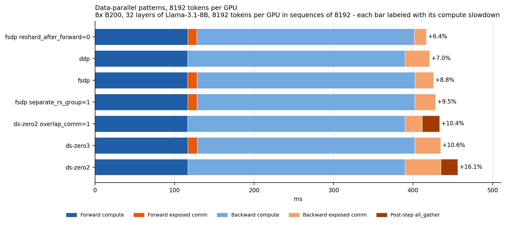
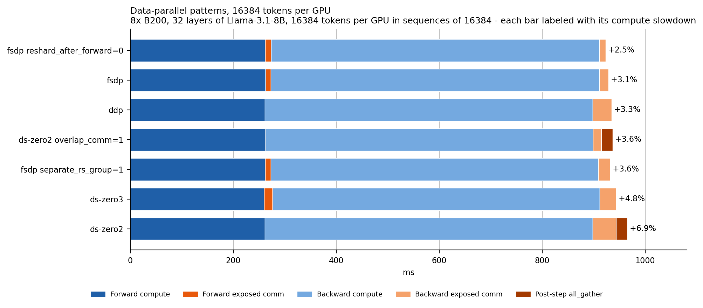
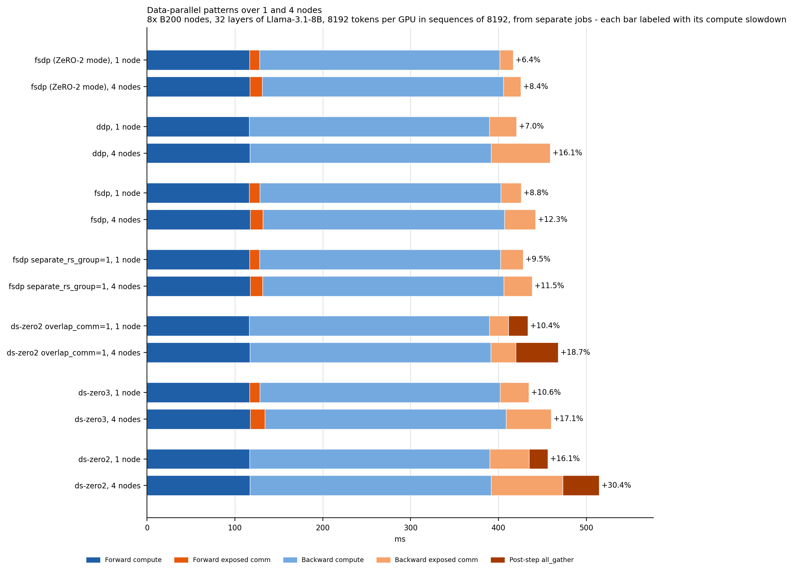
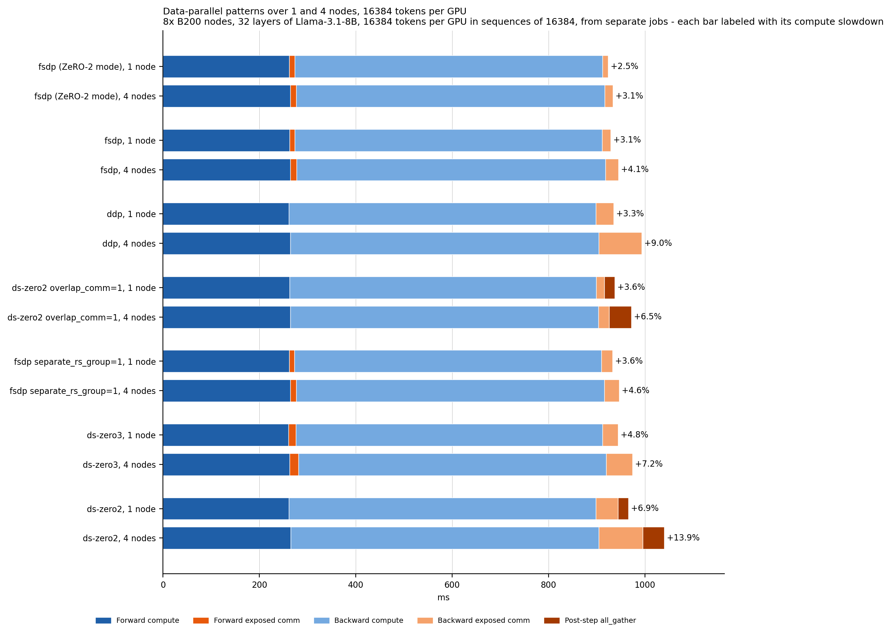
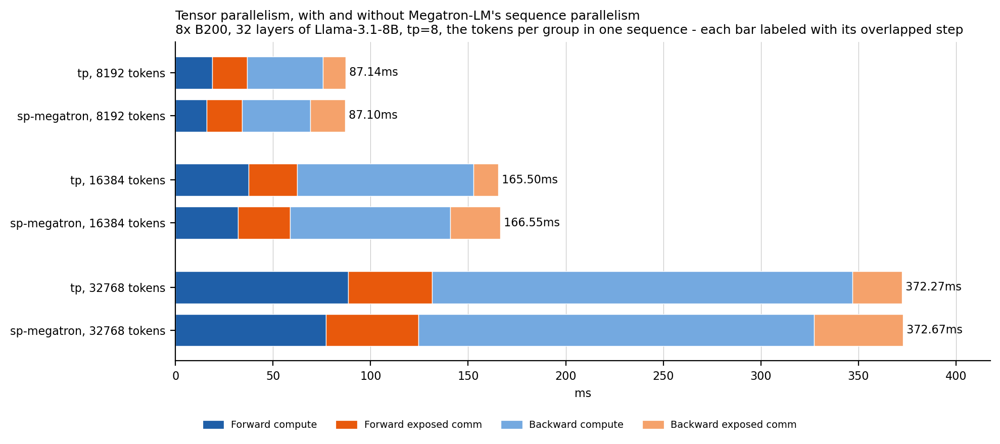
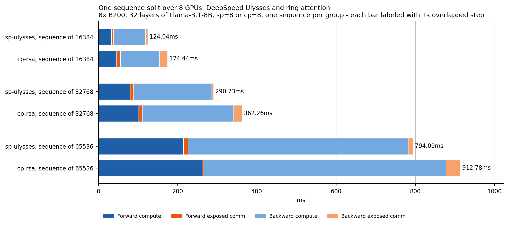
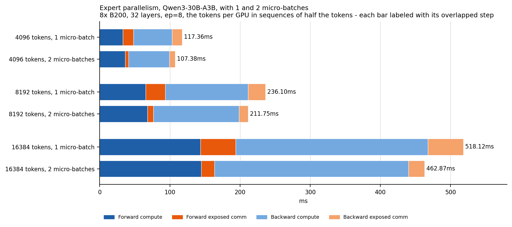
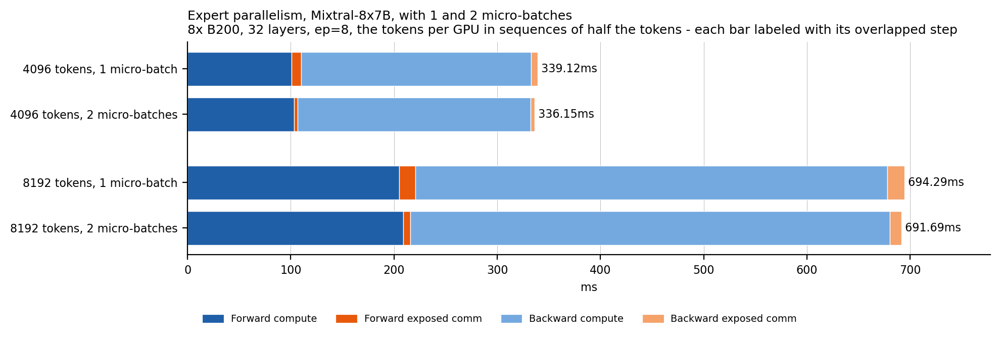
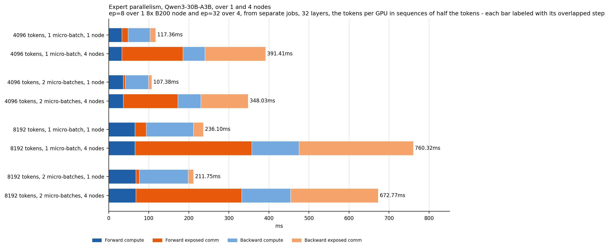

# Exposed Communication by Parallelism Pattern

In this chapter we explore the impact of performing concurrent communications and computation for various parallelism patterns. [comm-compute-overlap-bench.py](benchmarks/README.md#comm-compute-overlap-bench) was used to perform the measurements. This benchmark was run for multiple data and model parallelism patterns on one and four nodes, thus exercising both intra- and inter-node use cases.

All the numbers in this chapter were measured over NVLink within 1 8x B200 node, and over NVLink and [EFA](README.md#efa) across 4 of them, with 32 layers of Llama-3.1-8B and 8192 tokens per GPU, unless it says otherwise. If you need to understand your particular use case on a specific cluster you use, I highly recommend that you perform your own measurements.

The benchmark ran a training step's collectives on their own CUDA streams next to the compute of a stack of transformer layers, and timed the whole step and each of its phases - forward, backward and after the optimizer step - 3 ways:

- **compute alone** - the step without its collectives
- **comm alone** - the collectives without the compute
- **overlapped** - both together, as in training

From these it reported what the communication cost the step, in 3 metrics:

- **exposed comm** - how much longer the overlapped step took than the compute alone: the communication that didn't overlap with the compute, as in [Comms and compute overlap](README.md#comms-and-compute-overlap), plus how much the two slowed each other down, so it can come out longer than the comm alone.
- **comm cost** - the exposed comm as a percentage of the comm alone: 0% when all of the communication overlapped, 100% when none of it did, and above 100% when the step took longer still, as when the ranks waited at each collective for the slowest one.
- **compute slowdown** - the exposed comm as a percentage of the compute alone: how much longer the step took because of its communication, not how much slower the compute kernels ran.

Compute and communication slow each other down because kernels running at the same time compete for the SMs, the GPU's streaming multiprocessors, and for the memory bandwidth.

The benchmark has a pattern for each parallelism it measures, which the tables below name in their pattern column. Refer to [the benchmark's documentation](benchmarks/README.md#comm-compute-overlap-bench) to learn how to run each pattern and change its settings.

## Data-parallel patterns

The data-parallel patterns:

- **`ddp`** - PyTorch's [DDP](../training/model-parallelism/README.md#ddp): backward all-reduces the gradients in buckets of whole parameters, each as soon as it reaches the size in MiB that the `bucket_cap_mb` argument sets, while it goes on computing the gradients of the earlier layers.
- **`fsdp`** - PyTorch's [FSDP2](../training/model-parallelism/README.md#zero-data-parallelism), with `fully_shard()` on each transformer layer: each layer's parameters are all-gathered a layer ahead of its compute, in forward and again in backward unless `reshard_after_forward` is `False`, and backward reduce-scatters each layer's gradients. The reduce-scatters share the all-gathers' NCCL communicator, which runs its collectives one at a time, unless `separate_rs_group=1` gives them one of their own, as FSDP2's `set_separate_reduce_scatter_group()` method does.
- **`ds-zero2`** - DeepSpeed's [ZeRO-2](../training/model-parallelism/README.md#zero-data-parallelism): backward all-reduces the gradients in buckets of as many elements as the `reduce_bucket_size` config key sets, and after the optimizer step the updated parameters are all-gathered in one call. With the `overlap_comm` config key at its default, `overlap_comm=0`, the all-reduces run on the compute stream, so backward waits for each, and with `overlap_comm=1` they run on a stream of their own while backward goes on. With `overlap_comm=1` ZeRO-1 makes the same collectives, and the benchmark's `ds-zero1` pattern came within 0.2ms of `ds-zero2`, so the tables show only `ds-zero2`.
- **`ds-zero3`** - DeepSpeed's [ZeRO-3](../training/model-parallelism/README.md#zero-data-parallelism): each linear layer's weight is all-gathered when its module needs it, with a prefetch of the next weights of up to as many elements as the `stage3_prefetch_bucket_size` config key sets, and backward reduce-scatters the gradients in buckets of `reduce_bucket_size` elements on a stream of its own.

The next 2 sections give every pattern's measurements over 1 node and over 4, and the 4 after them explain what drove each pattern's numbers: [DDP's](#ddps-exposed-communication), [FSDP2's](#fsdp2s-exposed-communication), [DeepSpeed ZeRO-2's](#deepspeed-zero-2s-exposed-communication) and [DeepSpeed ZeRO-3's](#deepspeed-zero-3s-exposed-communication) exposed communication.

### Data-parallel patterns measured on a single node

Here is each pattern with the defaults of its framework unless the row names a setting, with 8192 tokens per GPU, sorted by compute slowdown, ascending. The compute alone took about 389ms:

| pattern                               | compute slowdown | comm alone ms | exposed comm ms | comm cost |
| :------------------------------------ | ------------------: | ------------------: | --------------------: | -----------: |
| `fsdp` with `reshard_after_forward=0` |                6.4% |             47.28ms |               25.02ms |          53% |
| `ddp`                                 |                7.0% |             54.16ms |               27.42ms |          51% |
| `fsdp`                                |                8.8% |             66.92ms |               34.17ms |          51% |
| `fsdp` with `separate_rs_group=1`     |                9.5% |             64.59ms |               37.18ms |          58% |
| `ds-zero2` with `overlap_comm=1`      |               10.4% |             55.51ms |               40.61ms |          73% |
| `ds-zero3`                            |               10.6% |             69.49ms |               41.18ms |          59% |
| `ds-zero2`                            |               16.1% |             57.88ms |               62.53ms |         108% |

`ddp` communicates only in backward. The FSDP2 rows and ZeRO-3 all-gather the parameters in forward as well, and all but `fsdp` with `reshard_after_forward=0` all-gather them again in backward. ZeRO-2 all-gathers them after the optimizer step, where no compute overlaps with it.

Here is each pattern's step split into its phases, in the order of the table above: the communication in forward, then in backward, then after the optimizer step, leaving out the phases that communicate nothing. Each phase is timed by its slowest rank, which isn't the same rank in every phase, so the phases add up to a little more than the step:

| pattern                               | phase                    | comm alone ms | exposed comm ms | comm cost |
| :------------------------------------ | :----------------------- | ------------------: | --------------------: | -----------: |
| `fsdp` with `reshard_after_forward=0` | forward                  |             22.30ms |               11.44ms |          51% |
| `fsdp` with `reshard_after_forward=0` | backward                 |             24.98ms |               14.99ms |          60% |
| `ddp`                                 | backward                 |             54.06ms |               30.87ms |          57% |
| `fsdp`                                | forward                  |             22.37ms |               11.80ms |          53% |
| `fsdp`                                | backward                 |             44.61ms |               23.19ms |          52% |
| `fsdp` with `separate_rs_group=1`     | forward                  |             22.33ms |               11.61ms |          52% |
| `fsdp` with `separate_rs_group=1`     | backward                 |             42.30ms |               26.02ms |          62% |
| `ds-zero2` with `overlap_comm=1`      | backward                 |             36.93ms |               21.42ms |          58% |
| `ds-zero2` with `overlap_comm=1`      | after the optimizer step |             18.49ms |               22.02ms |         119% |
| `ds-zero3`                            | forward                  |             24.39ms |               12.00ms |          49% |
| `ds-zero3`                            | backward                 |             45.13ms |               32.57ms |          72% |
| `ds-zero2`                            | backward                 |             39.34ms |               44.83ms |         114% |
| `ds-zero2`                            | after the optimizer step |             18.47ms |               21.18ms |         115% |

And drawn by [comm-compute-overlap-plot.py](benchmarks/comm-compute-overlap-plot.py): each bar is forward's compute alone and the communication exposed in forward, then the same for backward, then the communication exposed after the optimizer step, with the step's time as the label at the end of the bar:

The phases of `ddp` and the ZeRO rows added up to 3.5ms to 4.0ms more than their steps, and those of the FSDP2 rows 1.3ms to 1.7ms more, as FSDP2 [keeps the ranks closer together](#fsdp2s-exposed-communication).

Here are the same patterns with 16384 tokens per GPU, from the same run as the table above, sorted by compute slowdown, ascending:

| pattern                               | compute slowdown | comm alone ms | exposed comm ms | comm cost |
| :------------------------------------ | ------------------: | ------------------: | --------------------: | -----------: |
| `fsdp` with `reshard_after_forward=0` |                2.5% |             47.22ms |               22.25ms |          47% |
| `fsdp`                                |                3.1% |             66.91ms |               27.88ms |          42% |
| `ddp`                                 |                3.3% |             54.15ms |               29.85ms |          55% |
| `ds-zero2` with `overlap_comm=1`      |                3.6% |             55.56ms |               31.97ms |          58% |
| `fsdp` with `separate_rs_group=1`     |                3.6% |             65.47ms |               32.49ms |          50% |
| `ds-zero3`                            |                4.8% |             70.16ms |               42.91ms |          61% |
| `ds-zero2`                            |                6.9% |             57.88ms |               61.81ms |         107% |

The collectives took as long as with 8192 tokens, while the compute alone took about 897ms, more than twice as long, so every compute slowdown was smaller.

Here are their steps split into phases, as with 8192 tokens, in the order of the table above:

| pattern                               | phase                    | comm alone ms | exposed comm ms | comm cost |
| :------------------------------------ | :----------------------- | ------------------: | --------------------: | -----------: |
| `fsdp` with `reshard_after_forward=0` | forward                  |             22.26ms |               11.43ms |          51% |
| `fsdp` with `reshard_after_forward=0` | backward                 |             24.97ms |               12.04ms |          48% |
| `fsdp`                                | forward                  |             22.42ms |               10.63ms |          47% |
| `fsdp`                                | backward                 |             44.59ms |               17.79ms |          40% |
| `ddp`                                 | backward                 |             54.05ms |               36.81ms |          68% |
| `ds-zero2` with `overlap_comm=1`      | backward                 |             37.00ms |               16.26ms |          44% |
| `ds-zero2` with `overlap_comm=1`      | after the optimizer step |             18.49ms |               21.65ms |         117% |
| `fsdp` with `separate_rs_group=1`     | forward                  |             22.35ms |               10.92ms |          49% |
| `fsdp` with `separate_rs_group=1`     | backward                 |             43.30ms |               23.22ms |          54% |
| `ds-zero3`                            | forward                  |             24.27ms |               16.00ms |          66% |
| `ds-zero3`                            | backward                 |             45.90ms |               32.23ms |          70% |
| `ds-zero2`                            | backward                 |             39.33ms |               45.75ms |         116% |
| `ds-zero2`                            | after the optimizer step |             18.48ms |               21.53ms |         116% |

And the corresponding plot:

With the longer compute most rows exposed less in backward than with 8192 tokens, except `ddp`, as [DDP's exposed communication](#ddps-exposed-communication) explains, and ZeRO-3 exposed more in forward, as [DeepSpeed ZeRO-3's exposed communication](#deepspeed-zero-3s-exposed-communication) explains. `fsdp`, `ddp`, `ds-zero2` with `overlap_comm=1` and `fsdp` with `separate_rs_group=1` came within 0.5 percentage points of each other.

### Data-parallel patterns measured across nodes

The multi-node numbers were measured on 4 8x B200 nodes, 32 GPUs, with NVLink within each node and 8 400Gbps [EFA](README.md#efa) NICs per node between them (`torch=2.14.0+cu130`, `nccl=2.30.7`). They are likely to be different with another number of nodes, another GPU or another network.

Here are the data-parallel patterns over 4 nodes with 8192 tokens per GPU, sorted by compute slowdown, ascending. Their 1-node runs, from a separate run with the same software, are the 8192-token table of [Data-parallel patterns measured on a single node](#data-parallel-patterns-measured-on-a-single-node):

| pattern                               | compute slowdown | exposed comm ms | comm alone |
| :------------------------------------ | ------------------: | --------------------: | ------------: |
| `fsdp` with `reshard_after_forward=0` |                8.4% |               32.75ms |      121.09ms |
| `fsdp` with `separate_rs_group=1`     |               11.5% |               44.91ms |      138.75ms |
| `fsdp`                                |               12.3% |               48.36ms |      165.63ms |
| `ddp`                                 |               16.1% |               62.80ms |      140.72ms |
| `ds-zero3`                            |               17.1% |               66.89ms |      160.78ms |
| `ds-zero2` with `overlap_comm=1`      |               18.7% |               73.04ms |      114.62ms |
| `ds-zero2`                            |               30.4% |              118.68ms |      117.91ms |

Here is each pattern's step over 4 nodes split into its phases, in the order of the table above:

| pattern                               | phase                    | comm alone ms | exposed comm ms | comm cost |
| :------------------------------------ | :----------------------- | ------------------: | --------------------: | -----------: |
| `fsdp` with `reshard_after_forward=0` | forward                  |             50.52ms |               13.94ms |          28% |
| `fsdp` with `reshard_after_forward=0` | backward                 |             70.62ms |               19.55ms |          28% |
| `fsdp` with `separate_rs_group=1`     | forward                  |             50.08ms |               14.17ms |          28% |
| `fsdp` with `separate_rs_group=1`     | backward                 |             88.69ms |               32.23ms |          36% |
| `fsdp`                                | forward                  |             50.49ms |               14.42ms |          29% |
| `fsdp`                                | backward                 |            115.26ms |               35.22ms |          31% |
| `ddp`                                 | backward                 |            140.62ms |               67.00ms |          48% |
| `ds-zero3`                            | forward                  |             63.99ms |               16.65ms |          26% |
| `ds-zero3`                            | backward                 |             96.82ms |               51.12ms |          53% |
| `ds-zero2` with `overlap_comm=1`      | backward                 |             77.49ms |               28.46ms |          37% |
| `ds-zero2` with `overlap_comm=1`      | after the optimizer step |             37.10ms |               48.13ms |         130% |
| `ds-zero2`                            | backward                 |             80.83ms |               81.87ms |         101% |
| `ds-zero2`                            | after the optimizer step |             37.03ms |               41.22ms |         111% |

And the corresponding plot, with each pattern's 1-node step above its 4-node one:

The compute alone took as long over 4 nodes as over 1, ~389ms to ~392ms in every row, so only the communication grew. It took 2.0 to 2.6 times as long alone as over 1 node, and the patterns differed in how much of the added time they exposed: the FSDP2 rows 10% to 14% of it, ZeRO-3 28%, DDP 41%, and ZeRO-2 55% with `overlap_comm=1` and 94% with `overlap_comm=0`. So `ddp`, second over 1 node, fell behind all 3 FSDP2 rows.

Here they are with 16384 tokens per GPU, from the same run as the table above, sorted by compute slowdown, ascending. The 1-node runs are the 16384-token table of [Data-parallel patterns measured on a single node](#data-parallel-patterns-measured-on-a-single-node):

| pattern                               | compute slowdown | exposed comm ms | comm alone |
| :------------------------------------ | ------------------: | --------------------: | ------------: |
| `fsdp` with `reshard_after_forward=0` |                3.1% |               27.74ms |      121.21ms |
| `fsdp`                                |                4.1% |               37.24ms |      166.45ms |
| `fsdp` with `separate_rs_group=1`     |                4.6% |               41.69ms |      139.56ms |
| `ds-zero2` with `overlap_comm=1`      |                6.5% |               58.29ms |      114.77ms |
| `ds-zero3`                            |                7.2% |               64.61ms |      160.91ms |
| `ddp`                                 |                9.0% |               80.70ms |      140.68ms |
| `ds-zero2`                            |               13.9% |              124.84ms |      117.86ms |

Here are their steps over 4 nodes split into phases, in the order of the table above:

| pattern                               | phase                    | comm alone ms | exposed comm ms | comm cost |
| :------------------------------------ | :----------------------- | ------------------: | --------------------: | -----------: |
| `fsdp` with `reshard_after_forward=0` | forward                  |             50.69ms |               12.57ms |          25% |
| `fsdp` with `reshard_after_forward=0` | backward                 |             70.68ms |               17.21ms |          24% |
| `fsdp`                                | forward                  |             50.70ms |               13.48ms |          27% |
| `fsdp`                                | backward                 |            115.75ms |               26.62ms |          23% |
| `fsdp` with `separate_rs_group=1`     | forward                  |             50.86ms |               12.24ms |          24% |
| `fsdp` with `separate_rs_group=1`     | backward                 |             88.79ms |               30.89ms |          35% |
| `ds-zero2` with `overlap_comm=1`      | backward                 |             77.58ms |               22.12ms |          29% |
| `ds-zero2` with `overlap_comm=1`      | after the optimizer step |             37.15ms |               46.02ms |         124% |
| `ds-zero3`                            | forward                  |             63.92ms |               18.09ms |          28% |
| `ds-zero3`                            | backward                 |             96.73ms |               54.79ms |          57% |
| `ddp`                                 | backward                 |            140.58ms |               89.19ms |          63% |
| `ds-zero2`                            | backward                 |             80.75ms |               91.03ms |         113% |
| `ds-zero2`                            | after the optimizer step |             37.02ms |               44.88ms |         121% |

And the corresponding plot, with each pattern's 1-node step above its 4-node one:

The compute alone took ~894ms to ~903ms in every row, over 1 node and over 4, and every compute slowdown was 33% to 56% of that with 8192 tokens. `ddp` fell to sixth, as it exposed 50.9ms more than over 1 node, against 5.5ms to 9.4ms more for the FSDP2 rows. As over 1 node, the phases of `ddp` and the ZeRO rows overshot their steps by more than those of the FSDP2 rows, 9.5ms to 13.2ms against 4.1ms to 4.3ms.

### DDP's exposed communication

Now let's analyze each dp pattern.

`ddp` communicates only in backward, and over 1 node it overlapped about half of that with the compute, but over 4 nodes it fell behind all 3 FSDP2 rows, as its all-reduces no longer fit in backward.

DDP's bucket doesn't split a gradient: it closes once it reaches `bucket_cap_mb`, 25MiB by default, and Llama-3.1-8B's larger weights take 32MiB to 112MiB in bf16, so most weights get an all-reduce of their own: 5 per layer, 160 per step.

With 16384 tokens per GPU, over 1 node, the same all-reduces exposed more than with 8192: traces with NVIDIA's [Nsight Systems](https://developer.nvidia.com/nsight-systems) (`nsys`) profiler show them slowing each compute kernel next to them as much as with 8192 tokens, but more compute kernels ran next to them in the longer backward. The all-reduces take SMs from the compute, but limiting them to fewer CTAs didn't help: with [`NCCL_MAX_CTAS`](README.md#nccl_min_ctas-and-nccl_max_ctas) at 8 instead of the 24 that NCCL picked, their comm alone took twice as long, and in 3 runs of each the step took about 10ms longer with 8192 tokens, where they no longer fit in backward, and only 0.7ms to 2.3ms shorter with 16384.

Over 4 nodes the all-reduces ran twice as long during backward as in the comm alone, and about 27 of the 160 were still running or queued when backward's compute ended: the step waited about 30ms for them, against under 3ms over 1 node.

### FSDP2's exposed communication

FSDP2 exposed the least communication over 4 nodes, and `fsdp` with `reshard_after_forward=0`, which takes more memory, exposed the least over 1 node too.

`reshard_after_forward=0` keeps the gathered parameters from forward to backward, 13GiB for 32 layers of Llama-3.1-8B, so backward only reduce-scatters, while the default `fsdp` all-gathers them again in backward.

About 40% of what `fsdp`'s forward exposed isn't communication: FSDP2 copies each layer's gathered parameters out of the all-gather's buffer on the compute stream, 0.14ms per layer in an `nsys` trace. The copies don't depend on the token count, so forward exposed about as much with 16384 tokens per GPU.

On a shared communicator an all-gather waits for the reduce-scatter before it, as section 3.3.2 of the [PyTorch FSDP paper](https://arxiv.org/abs/2304.11277) explains, and `separate_rs_group=1` removes that wait. Over 1 node that made backward worse, as the two collectives running at once took 32 SMs each and slowed the matmuls next to them, but over 4 nodes, where the collectives take longer, it made the step faster, 44.91ms exposed against 48.36ms.

FSDP2 keeps the ranks closer together than DDP and ZeRO do: each all-gather waits for its GPU's compute to copy out the previous layer's parameters, so on a faster GPU it starts earlier and holds its SMs longer while it waits for the other GPUs, which slows that GPU down.

### DeepSpeed ZeRO-2's exposed communication

I recommend you to turn `overlap_comm` on: with its default, `overlap_comm=0`, backward waits for each all-reduce, so ZeRO-2 exposed all of its communication and added the most of all the patterns, 16.1% over 1 node and 30.4% over 4, and `overlap_comm=1` cut that to 10.4% and 18.7%. ZeRO-1 with `overlap_comm=0` all-reduces the gradients only after backward, and exposed 8% to 12% more than ZeRO-2.

Even with `overlap_comm=1`, ZeRO-2's all-gather of the updated parameters after the optimizer step doesn't overlap with compute at all: it was about half of what ZeRO-2 exposed over 1 node, and two thirds over 4. It also took longer in the step than in the comm alone, at a comm cost above 100%, though in nsys traces all 8 GPUs started it within 0.02ms of each other, so none of them waited for a slower one, and no compute ran next to it. These traces don't show why.

Here is ZeRO-2's compute slowdown and comm alone over 1 node with `overlap_comm=1` against its `reduce_bucket_size`, which counts elements and defaults to 5e8 (bolded row), sorted by `reduce_bucket_size`, ascending:

| `reduce_` `bucket_size` | in bf16    | calls  | compute slowdown | comm alone |
| -------------------------: | ---------: | -----: | ------------------: | ------------: |
|                     1.31e7 |      25MiB |    192 |               13.3% |       72.03ms |
|                     1.25e8 |     238MiB |     64 |               10.4% |       59.98ms |
|                      2.5e8 |     477MiB |     32 |               10.6% |       56.48ms |
|                    **5e8** | **954MiB** | **15** |           **10.4%** |   **55.51ms** |
|                        1e9 |    1907MiB |      8 |               10.7% |       55.42ms |

And the same over 4 nodes:

| `reduce_` `bucket_size` | in bf16    | calls  | compute slowdown | comm alone |
| -------------------------: | ---------: | -----: | ------------------: | ------------: |
|                     1.31e7 |      25MiB |    192 |               31.4% |      184.84ms |
|                     1.25e8 |     238MiB |     64 |               18.0% |      141.43ms |
|                      2.5e8 |     477MiB |     32 |               18.5% |      134.89ms |
|                    **5e8** | **954MiB** | **15** |           **18.7%** |  **114.62ms** |
|                        1e9 |    1907MiB |      8 |               19.6% |      112.27ms |

Only buckets far below the default cost more: 1.31e7 elements, 25MiB in bf16 like DDP's default cap, made 192 calls against 15, each with a fixed cost, while from a quarter of the default to twice it the compute slowdown stayed within 0.3 percentage points over 1 node and 1.6 over 4. The [PyTorch DDP paper](https://arxiv.org/abs/2006.15704) describes the same trade-off: bigger buckets mean fewer calls, but a longer wait for the first bucket to fill.

### DeepSpeed ZeRO-3's exposed communication

ZeRO-3 exposed more than the default `fsdp`, 41.18ms against 34.17ms over 1 node and 66.89ms against 48.36ms over 4, with about as much communication alone, and over 1 node the difference was all in backward.

In backward ZeRO-3's all-gathers share a communicator with its gradient reduce-scatters, so an all-gather that the next layer needs can wait for a reduce-scatter to finish, and the compute waits for the all-gather. FSDP2's all-gathers queue the same way, but each starts a whole layer before its compute needs it, while ZeRO-3's default `stage3_prefetch_bucket_size` of 5e7 elements is less than one of Llama-3.1-8B's largest weights, so it prefetches about one weight ahead. In `nsys` traces over 4 nodes, about half of the time that ZeRO-3's compute waited for all-gathers went to those that had queued behind a reduce-scatter.

ZeRO-3's forward exposed a third more with 16384 tokens per GPU than with 8192, almost all of it as compute slowed by the all-gathers rather than waiting for them: in nsys traces over 1 node the forward's all-gathers took 27ms in the comm alone, but ran for 59ms next to the compute with 8192 tokens and 92ms with 16384, and the longer they ran next to it, the more compute they slowed.

Here is ZeRO-3 over 4 nodes with 8192 tokens per GPU, with its defaults (bolded row) and with the settings the benchmark tried instead: a larger `stage3_prefetch_bucket_size`, a smaller `reduce_bucket_size`, which defaults to 5e8, and the reduce-scatters on a communicator of their own, which DeepSpeed doesn't offer and the benchmark was patched for, sorted by compute slowdown, ascending:

| `stage3_` `prefetch_` `bucket_size` | `reduce_` `bucket_size` | reduce- scatter communicator | compute slowdown | comm alone | exposed comm |
| ----------------------------------------: | -------------------------: | :--------------------------------- | ------------------: | ------------: | --------------: |
|                                     2.5e8 |                        5e8 | separate                           |               11.1% |      148.42ms |         43.28ms |
|                                       5e7 |                        5e8 | separate                           |               11.6% |      150.25ms |         45.37ms |
|                                       1e9 |                        5e8 | shared                             |               15.2% |      158.08ms |         59.23ms |
|                                       1e8 |                        5e8 | shared                             |               15.3% |      160.01ms |         59.95ms |
|                                       5e8 |                        5e8 | shared                             |               15.3% |      158.65ms |         59.68ms |
|                                     2.5e8 |                        5e8 | shared                             |               15.4% |      158.91ms |         60.08ms |
|                                   **5e7** |                    **5e8** | **shared**                         |           **17.1%** |  **160.78ms** |     **66.89ms** |
|                                     2.5e8 |                      2.5e7 | shared                             |               23.2% |      192.87ms |         90.65ms |
|                                     2.5e8 |                        1e8 | shared                             |               23.7% |      182.47ms |         92.65ms |
|                                       5e7 |                        1e8 | shared                             |               24.5% |      187.77ms |         95.85ms |
|                                       5e7 |                      2.5e7 | shared                             |               27.4% |      198.61ms |        107.03ms |

A larger prefetch bucket cut the exposed communication by only about 7ms, and smaller reduce buckets made it worse, as more, smaller reduce-scatters took longer in the comm alone. Only moving the reduce-scatters to a communicator of their own, so that the all-gathers no longer queued behind them, brought ZeRO-3 below `fsdp`'s 48.36ms.

### Data-parallel patterns with gradient accumulation

With gradient accumulation each optimizer step runs several micro-batches, each a forward and a backward, and sums their gradients. The benchmark's `gas` setting, named after DeepSpeed's `gradient_accumulation_steps` config key, sets the number of micro-batches. A pattern gains from more of them only as far as it skips its collectives in all but the last micro-batch:

- `ddp` all-reduces the gradients only in the last micro-batch's backward: DDP's [`no_sync()`](https://docs.pytorch.org/docs/stable/generated/torch.nn.parallel.DistributedDataParallel.html#torch.nn.parallel.DistributedDataParallel.no_sync) context manager skips it in the others.
- `ds-zero1` also reduces the gradients only in the last micro-batch, while `ds-zero2`, which keeps only its shard of the gradients, reduces them in every micro-batch, as [DeepSpeed's ZeRO-1 and ZeRO-2 code](https://github.com/deepspeedai/DeepSpeed/blob/master/deepspeed/runtime/zero/stage_1_and_2.py) does. Both all-gather the updated parameters once per step. As they differ here, the tables below show both, each with `overlap_comm=1`.
- `ds-zero3` and `fsdp` all-gather the parameters in every micro-batch's forward and backward, and reduce-scatter the gradients in every backward.
- FSDP2 can skip some of that in all the micro-batches but the last: [`set_requires_gradient_sync(False)`](https://docs.pytorch.org/docs/stable/distributed.fsdp.fully_shard.html#torch.distributed.fsdp.FSDPModule.set_requires_gradient_sync), `fsdp`'s `requires_gradient_sync=0`, accumulates the gradients unsharded instead of reduce-scattering them, and [`set_reshard_after_backward(False)`](https://docs.pytorch.org/docs/stable/distributed.fsdp.fully_shard.html#torch.distributed.fsdp.FSDPModule.set_reshard_after_backward), `reshard_after_backward=0`, keeps the parameters gathered after backward, so the next forward doesn't all-gather them again. Backward still does, unless `reshard_after_forward=0` as well: then FSDP2 all-gathers the parameters only once per step.

Here is each pattern's compute slowdown over 1 node with `gas=1` and `gas=8`, 8192 tokens per GPU in each micro-batch, sorted by the compute slowdown with `gas=8`, ascending:

| pattern                                                                                                | `gas=1` | `gas=8` |
| :----------------------------------------------------------------------------------------------------- | ------: | ------: |
| `fsdp` with `requires_gradient_sync=0`, `reshard_after_backward=0`, `reshard_after_forward=0` |    6.4% |    0.6% |
| `ddp`                                                                                                  |    7.0% |    0.9% |
| `ds-zero1` with `overlap_comm=1`                                                                       |   10.5% |    1.1% |
| `fsdp` with `requires_gradient_sync=0`, `reshard_after_backward=0`                               |    8.6% |    3.7% |
| `ds-zero2` with `overlap_comm=1`                                                                       |   10.5% |    5.1% |
| `fsdp`                                                                                                 |    8.9% |    8.6% |
| `ds-zero3`                                                                                             |   10.7% |   10.5% |

And over 4 nodes, sorted the same way. With `gas=1` the FSDP2 settings for accumulation change nothing, so the first `fsdp` row's `gas=1` cell comes from `fsdp` with only `reshard_after_forward=0`, and the second's from `fsdp`:

| pattern                                                                                                | `gas=1` | `gas=8` |
| :----------------------------------------------------------------------------------------------------- | ------: | ------: |
| `fsdp` with `requires_gradient_sync=0`, `reshard_after_backward=0`, `reshard_after_forward=0` |    8.4% |    0.9% |
| `ddp`                                                                                                  |   16.1% |    1.8% |
| `ds-zero1` with `overlap_comm=1`                                                                       |   18.4% |    2.1% |
| `fsdp` with `requires_gradient_sync=0`, `reshard_after_backward=0`                               |   12.3% |    4.6% |
| `ds-zero2` with `overlap_comm=1`                                                                       |   18.7% |    7.1% |
| `fsdp`                                                                                                 |   12.3% |   11.8% |
| `ds-zero3`                                                                                             |   17.1% |   16.4% |

The patterns that communicate once per step, `ddp`, `ds-zero1` and `fsdp` with all 3 settings at 0, exposed about as much with `gas=8` as with `gas=1`, so with 8.3 times the compute alone their compute slowdown fell to about a tenth. `fsdp` and `ds-zero3` communicate in every micro-batch, so their communication grew with the compute, and their compute slowdown hardly changed. `ds-zero2` and `fsdp` with 2 of the settings landed in between, as each still repeats part of its communication in every micro-batch: ZeRO-2 its gradient all-reduces, and that `fsdp` row its all-gathers in backward.

So gradient accumulation reverses how ZeRO-1 and ZeRO-2 compare with the default `fsdp`: with `gas=1` `fsdp` added less than both, and with `gas=8` more. FSDP2 with all 3 settings at 0 added the least either way, by trading memory for communication: the gradients accumulate unsharded, and the parameters stay gathered from the first forward to the optimizer step.

## Other parallelism patterns

The other parallelism patterns, each over groups of as many GPUs as its degree setting, which the tables below show in their degrees column, e.g. `tp=8`:

- **`tp`** - Megatron-LM's [tensor parallelism](../training/model-parallelism/README.md#tensor-parallelism): each layer's matmuls are split over the group, and their partial outputs are all-reduced in forward, while backward all-reduces each input gradient during the compute of the matching weight gradient.
- **`sp-megatron`** - Megatron-LM's [sequence parallelism](../training/model-parallelism/README.md#megatron-lms-sp), which runs only together with its tensor parallelism: `tp`, but each GPU runs the elementwise ops between the split matmuls, such as the residual adds, on its share of the tokens, so each all-reduce becomes an all-gather before the split matmuls and a reduce-scatter after them.
- **`sp-ulysses`** - DeepSpeed's [Ulysses](../training/model-parallelism/README.md#deepspeed-ulysses-sp): each GPU has a piece of one sequence, and all-to-alls before and after attention switch from splitting the sequence to splitting the attention heads, and back.
- **`cp-rsa`** - Transformer Engine's context parallelism with [ring self-attention](../training/model-parallelism/README.md#ring-attention-with-blockwise-transformers): each GPU has a piece of one sequence, and computes attention to one GPU's keys and values while it sends them on to the next GPU in the ring. Each ring step's attention, forward and backward, is queued as one CUDA graph unless the `cuda_graphs` setting is 0.
- **`ep`** - Megatron-LM's Mixture-of-Experts [expert parallelism](../training/model-parallelism/README.md#expert-parallelism): all-to-alls send each token to the GPUs of its experts and back, and with `micro_batches=2` the all-to-alls of one micro-batch run during the compute of the other. With `dispatcher=deepep` it runs [DeepEP](https://github.com/deepseek-ai/DeepEP)'s dispatch and combine in their place - see [DeepEP measured on a single node](#deepep-measured-on-a-single-node).
- **`pp`** - Megatron-LM's interleaved 1F1B [pipeline parallelism](../training/model-parallelism/README.md#pipeline-parallelism): the layers are split into chunks of consecutive layers, 2 or more on each GPU, and each micro-batch goes through the chunks in order, each GPU sending a chunk's output to the GPU of the next chunk, and in backward the gradient of its input to the GPU of the previous one. A fourth trial runs the schedule with 1-element sends, which times the pipeline bubble: the time the GPUs wait for each other's compute.

The next section gives the measurements of `tp`, `sp-megatron`, `sp-ulysses` and `cp-rsa` over 1 node, and the 4 after it explain what drove each pattern's numbers, over 1 node and, where its groups can cross nodes, over 4, or 2 for pipeline parallelism: [tensor parallelism's](#tensor-parallelisms-exposed-communication), [sequence and context parallelism's](#sequence-and-context-parallelisms-exposed-communication), [expert parallelism's](#expert-parallelisms-exposed-communication) and [pipeline parallelism's](#pipeline-parallelisms-exposed-communication) exposed communication.

### Other parallelism patterns measured on a single node

Each pattern's groups spanned all 8 GPUs (`torch=2.14.0+cu130`, `nccl=2.30.7`).

Here is each pattern with each of its token counts, sorted by compute slowdown, ascending:

| pattern       | degrees | tokens | sequence length | compute slowdown | comm alone ms | exposed comm ms | comm cost |
| :------------ | :------ | -----: | -----------------: | ------------------: | ------------------: | --------------------: | -----------: |
| `sp-ulysses`  | sp=8    |   8192 |              65536 |                3.2% |             23.76ms |               24.34ms |         102% |
| `cp-rsa`      | cp=8    |   8192 |              65536 |                4.8% |            281.45ms |               41.65ms |          15% |
| `sp-ulysses`  | sp=8    |   4096 |              32768 |                5.1% |             14.80ms |               14.02ms |          95% |
| `sp-ulysses`  | sp=8    |   2048 |              16384 |                9.5% |              9.35ms |               10.71ms |         115% |
| `cp-rsa`      | cp=8    |   4096 |              32768 |                9.7% |            145.93ms |               32.06ms |          22% |
| `cp-rsa`      | cp=8    |   2048 |              16384 |               21.5% |             77.68ms |               30.90ms |          40% |
| `tp`          | tp=8    |  32768 |              32768 |               22.6% |             91.64ms |               68.70ms |          75% |
| `tp`          | tp=8    |  16384 |              16384 |               29.5% |             50.53ms |               37.73ms |          75% |
| `sp-megatron` | tp=8    |  32768 |              32768 |               33.7% |            129.39ms |               93.89ms |          73% |
| `sp-megatron` | tp=8    |  16384 |              16384 |               46.4% |             66.93ms |               52.79ms |          79% |
| `tp`          | tp=8    |   8192 |               8192 |               50.9% |             35.51ms |               29.41ms |          83% |
| `sp-megatron` | tp=8    |   8192 |               8192 |               70.4% |             44.48ms |               35.98ms |          81% |

Notes:
- TP: tensor parallelism.
- SP: sequence parallelism - with `sp-megatron` Megatron-LM's, which splits the tokens between the split matmuls, and with `sp-ulysses` DeepSpeed Ulysses, which splits a sequence and attention heads over multiple GPUs.
- CP: context parallelism, which also splits one sequence over the GPUs, here with ring self-attention.
- tokens: per tensor-parallel group with `tp` and `sp-megatron`, and per GPU with the others, so the sequence length of `sp-ulysses` and `cp-rsa` is 8 times their tokens.

### Tensor parallelism's exposed communication

Tensor parallelism exposed about all of its forward communication and part of its backward communication, and Megatron-LM's sequence parallelism made the steps no faster.

In forward each all-reduce sums the output of the matmul just before it, and the next matmul needs the sum, so none of it can overlap with compute. In backward each input gradient is all-reduced, or reduce-scattered with sequence parallelism, while the weight gradient is computed. For that, Megatron-LM's [linear layers](https://github.com/NVIDIA/Megatron-LM/blob/main/megatron/core/tensor_parallel/layers.py) rely on the `CUDA_DEVICE_MAX_CONNECTIONS=1` environment variable to start those collectives before the matmuls they overlap with, and the `tp` and `sp-megatron` patterns set it unless it's set already: with it at 8, both exposed almost all of their backward communication, against about two thirds with 1.

Here are the `tp` and `sp-megatron` steps split into phases:

`sp-megatron`'s compute alone was 8% to 11% shorter than `tp`'s, as the elementwise ops run on 1/8 of the tokens, but it communicates more, as its backward all-gathers the inputs of the column-parallel matmuls again for their weight gradients, and its steps took as long as `tp`'s, within 1.1ms.

`tp` and `sp-megatron` split the attention heads, and Llama-3.1-8B's 8 KV heads can't be split over more than 8 GPUs, so their groups stay within a node, where none of their communication crosses the network.

### Sequence and context parallelism's exposed communication

DeepSpeed Ulysses can't overlap any of its communication with compute, while ring attention overlaps more of it the longer the sequence, but computes attention slower, so over 1 node `sp-ulysses` took less time than `cp-rsa` for every sequence measured.

`sp-ulysses` exposed about all of its communication: each all-to-all needs the output of the compute before it, and the compute after it needs its output. Its comm cost went above 100% as the GPUs waited inside each all-to-all for the one whose compute before it finished last. Like `tp`, it splits the attention heads, so its groups stay within a node.

`cp-rsa` overlapped more of its communication the longer the sequence: doubling the sequence quadruples each ring step's attention compute, while the keys and values sent only double.

Here are the `sp-ulysses` and `cp-rsa` steps for the same sequences, split into phases:

`cp-rsa` exposed less communication, but its steps took 15% to 41% longer than those of `sp-ulysses`, as the benchmark's ring attention computes each layer's attention in 8 smaller blocks, one per ring step, which ran at 781 to 878 TFLOPS, against about 1000 for the single attention call of `sp-ulysses`.

`cp-rsa` splits the sequence rather than the heads, so with `cp=32` its ring of 32 GPUs crosses the nodes. Here it is on the 4 8x B200 nodes of [Data-parallel patterns measured across nodes](#data-parallel-patterns-measured-across-nodes), with 32 layers of Llama-3.1-8B, against `cp=8` over 1 node, sorted by compute slowdown, ascending:

| pattern  | degrees | nodes | tokens | sequence length | CUDA graphs | compute slowdown | comm alone ms | exposed comm ms | comm cost |
| :------- | :------ | ----: | -----: | -----------------: | :------------- | ------------------: | ------------------: | --------------------: | -----------: |
| `cp-rsa` | cp=8    |     1 |   2048 |              16384 | yes            |               21.5% |             77.68ms |               30.90ms |          40% |
| `cp-rsa` | cp=32   |     4 |   4096 |             131072 | no             |               40.2% |           1063.88ms |              373.74ms |          35% |
| `cp-rsa` | cp=32   |     4 |   2048 |              65536 | yes            |              100.0% |            545.32ms |              325.32ms |          60% |

With `cp=32` each GPU's ring has 31 steps instead of 7, so its communication alone took 7 times as long, while its compute alone took only 2.3 times as long, from running its queries against 4 times as many keys. So 60% of the communication stayed exposed, against 40% within a node. With 8192 tokens per GPU the step ran out of memory.

The 4096-token row ran without the CUDA graphs, which ran out of memory. Without them the host can't queue backward's kernels as fast as the GPU runs them, so the compute alone takes longer, and the same exposed communication makes a smaller compute slowdown: with 2048 tokens per GPU it came out at 38.6% without the graphs, against 100% with them, for about the same exposed communication. So compare that row with the others by its exposed communication.

### Expert parallelism's exposed communication

Expert parallelism exposes about all of its communication unless the tokens are split into 2 micro-batches, and over 4 nodes even 2 micro-batches left 80% of it exposed. That is with NCCL's `all_to_all` calls: over 1 node, DeepEP's dispatch and combine made the same steps 8% to 13% faster, as [measured below](#deepep-measured-on-a-single-node).

Here is `ep` over 1 node, with 32 layers of Mixtral-8x7B and of Qwen3-30B-A3B, in sequences of half the tokens, so that one and two micro-batches (the mbs column) differ only in the micro-batches, sorted by compute slowdown, ascending. Mixtral-8x7B with 16384 tokens didn't fit, as the benchmark keeps every collective output of the step in memory, to feed its [compute alone](benchmarks/README.md#comm-compute-overlap-bench):

| model         | degrees | tokens | sequence length | mbs  | compute slowdown | comm alone ms | exposed comm ms | comm cost |
| :------------ | :------ | -----: | -----------------: | ---: | ------------------: | ------------------: | --------------------: | -----------: |
| Mixtral-8x7B  | ep=8    |   4096 |               2048 |    2 |                2.2% |             21.10ms |                7.39ms |          35% |
| Mixtral-8x7B  | ep=8    |   8192 |               4096 |    2 |                2.7% |             34.42ms |               18.24ms |          53% |
| Mixtral-8x7B  | ep=8    |   4096 |               2048 |    1 |                5.0% |             17.17ms |               16.03ms |          93% |
| Mixtral-8x7B  | ep=8    |   8192 |               4096 |    1 |                5.2% |             30.18ms |               34.02ms |         113% |
| Qwen3-30B-A3B | ep=8    |  16384 |               8192 |    2 |                9.9% |            112.37ms |               41.62ms |          37% |
| Qwen3-30B-A3B | ep=8    |   8192 |               4096 |    2 |               11.5% |             60.60ms |               21.85ms |          36% |
| Qwen3-30B-A3B | ep=8    |   4096 |               2048 |    2 |               13.7% |             34.41ms |               12.91ms |          38% |
| Qwen3-30B-A3B | ep=8    |  16384 |               8192 |    1 |               24.1% |            107.39ms |              100.65ms |          94% |
| Qwen3-30B-A3B | ep=8    |   8192 |               4096 |    1 |               28.7% |             56.08ms |               52.64ms |          94% |
| Qwen3-30B-A3B | ep=8    |   4096 |               2048 |    1 |               33.5% |             30.23ms |               29.45ms |          97% |

With one micro-batch `ep` exposed about all of its communication, as each dispatch all-to-all needs the router's output, and the experts need the dispatched tokens. With `micro_batches=2` it exposed about a third to a half of it.

Here are the Qwen3-30B-A3B steps with one and two micro-batches, split into phases:

With 2 micro-batches each matmul computes half the tokens, which made the compute alone up to 7.5% longer, but the steps took 8.5% to 10.7% less time.

And the same for Mixtral-8x7B:

Mixtral-8x7B's experts compute more per token sent, so it exposed little communication to begin with, and the 2% that 2 micro-batches added to its compute alone took back almost all the time they saved: the steps took less than 1% less time.

Here is Qwen3-30B-A3B on the same 4 8x B200 nodes with `ep=32`, so that its 128 experts are split 4 per GPU and the all-to-alls cross the nodes, with 4096 and 8192 tokens per GPU, sorted by compute slowdown, ascending:

| model         | degrees | tokens | sequence length | mbs  | compute slowdown | comm alone ms | exposed comm ms | comm cost |
| :------------ | :------ | -----: | -----------------: | ---: | ------------------: | ------------------: | --------------------: | -----------: |
| Qwen3-30B-A3B | ep=32   |   8192 |               4096 |    2 |              254.8% |            609.29ms |              483.18ms |          79% |
| Qwen3-30B-A3B | ep=32   |   4096 |               2048 |    2 |              270.9% |            317.56ms |              254.21ms |          80% |
| Qwen3-30B-A3B | ep=32   |   8192 |               4096 |    1 |              313.8% |            582.77ms |              576.60ms |          99% |
| Qwen3-30B-A3B | ep=32   |   4096 |               2048 |    1 |              344.5% |            304.44ms |              303.35ms |         100% |

And with `ep=8` over 1 node, sorted the same way:

| model         | degrees | tokens | sequence length | mbs  | compute slowdown | comm alone ms | exposed comm ms | comm cost |
| :------------ | :------ | -----: | -----------------: | ---: | ------------------: | ------------------: | --------------------: | -----------: |
| Qwen3-30B-A3B | ep=8    |   8192 |               4096 |    2 |               11.5% |             60.60ms |               21.85ms |          36% |
| Qwen3-30B-A3B | ep=8    |   4096 |               2048 |    2 |               13.7% |             34.41ms |               12.91ms |          38% |
| Qwen3-30B-A3B | ep=8    |   8192 |               4096 |    1 |               28.7% |             56.08ms |               52.64ms |          94% |
| Qwen3-30B-A3B | ep=8    |   4096 |               2048 |    1 |               33.5% |             30.23ms |               29.45ms |          97% |

Over 4 nodes the all-to-alls alone took about 10 times as long as over 1 node, and 3.2 to 3.5 times as long as the compute alone. 24 of the 32 GPUs that each GPU sends to are on other nodes, so 42GB/s to 44GB/s per GPU left its node, close to the 50GB/s of the 400Gbps NIC that each GPU has. With so little compute to overlap with, 80% of the communication stayed exposed even with 2 micro-batches.

Here are those steps over 1 node and over 4, split into phases:

The compute stayed the same, and over 4 nodes the steps took 3.2 to 3.3 times as long as over 1 node, with one micro-batch or two.

#### Optimized expert parallelism

The `ep` pattern measures expert parallelism the basic way, as Megatron-LM's `alltoall` token dispatcher runs it: NCCL `all_to_all` calls that the CPU launches, that run on SMs the compute can't use meanwhile, and that send each of a token's top_k copies on its own - twice to the same GPU when 2 of its experts are there, and over the inter-node network once per expert on another node rather than once per node. The notable libraries below were written for MoE's dispatch and combine, and expose less of that communication in 4 ways: they send fewer bytes, they start the transfers from the GPU, they leave more of the SMs to the compute, and some fuse the communication into the expert compute. Only DeepEP was measured here, over 1 node, in [DeepEP measured on a single node](#deepep-measured-on-a-single-node).

Here is each of them and what it does differently from the `ep` pattern:

- **[DeepEP](https://github.com/deepseek-ai/DeepEP)** - DeepSeek's library. Its high-throughput kernels, for training and prefill, send each token over RDMA once to each node it's routed to and forward it to its experts' GPUs over NVLink, so the inter-node network carries each token once per node, and they can dispatch in FP8, half the bytes of bf16. Its low-latency kernels, for decoding, have the GPU post the RDMA writes itself, and with `return_recv_hook` the transfer runs on the NIC while the compute keeps all the SMs. More on it in [Other collective libraries](README.md#other-collective-libraries).
- **[Hybrid-EP](https://developer.nvidia.com/blog/optimizing-communication-for-mixture-of-experts-training-with-hybrid-expert-parallel/)** - NVIDIA's dispatch and combine for Megatron-Core's flex dispatcher, which DeepEP can also back. It copies over NVLink with TMA instructions, has the GPU post the RDMA writes, streams the tokens in small chunks through the NVLink and RDMA stages at once, and takes fewer SMs than DeepEP, which NVIDIA reported made DeepSeek-V3 training about 14% faster.
- **[NCCL EP](https://github.com/NVIDIA/nccl/tree/master/contrib/nccl_ep)** - dispatch and combine inside NCCL, on NCCL's device API: its high-throughput mode gathers a node's tokens over NVLink before sending them over RDMA, its low-latency mode sends straight to the experts' GPUs, and both are started from the GPU, while keeping NCCL's topology detection and network plugins.
- **[UCCL-EP](https://arxiv.org/abs/2512.19849)** ([code](https://github.com/uccl-project/uccl/tree/main/ep)) - DeepEP's dispatch and combine on hardware DeepEP doesn't run on, such as AWS EFA and Broadcom NICs and AMD GPUs, with CPU threads posting the RDMA writes for the GPU. Its authors measured up to 2.1 times the dispatch and combine throughput of the best other option on EFA.
- **TensorRT-LLM's [one-sided NVLink all-to-all](https://nvidia.github.io/TensorRT-LLM/blogs/tech_blog/blog18_Optimizing_MoE_Communication_with_One_Sided_AlltoAll_Over_NVLink.html)**, also in FlashInfer - for one NVLink domain, such as 8 B200s or the 72 GPUs of a GB200 NVL72 rack: each GPU maps the others' memory, and each kernel only writes to it or only reads from it, with no send and receive handshake, sending each token once per GPU.
- **[Mixture-of-Kittens](https://github.com/cursor/mixture-of-kittens)** - Cursor's MoE training kernel for GB200 and GB300 NVL72 racks, which runs dispatch, the experts and combine, forward and backward, as one kernel with no CPU-GPU synchronization. A third or less of the SMs pull each small batch of tokens from the GPUs that hold them with TMA loads, which is enough to fill NVLink, and signal the rest of the SMs, which compute the experts on it while the next one arrives, through a fixed-size ring buffer rather than a buffer for all the tokens. Cursor [measured](https://cursor.com/blog/mixture-of-kittens) up to 2.37 times the MXFP8 forward throughput of the fastest of DeepEP and Hybrid-EP on GB300 NVL72 racks.
- **[COMET](https://arxiv.org/abs/2502.19811)** ([code](https://github.com/bytedance/flux)) - ByteDance's fusion of the dispatch and combine into the expert matmuls, which splits the thread blocks between matmul and NVSHMEM communication, so that each tile of tokens is computed as soon as it arrives. Its authors measured MoE layers up to 1.96 times faster.

The schedule can also give the all-to-alls more compute to overlap with, of which the `micro_batches=2` setting of the `ep` pattern is the simplest form. [DualPipe](https://github.com/deepseek-ai/DualPipe) runs one micro-batch's all-to-alls during another's forward or backward compute in a bidirectional pipeline, and Megatron-Core's `--overlap-moe-expert-parallel-comm` merges the forward and backward of adjacent micro-batches to do the same. [Megatron-Core's MoE guide](https://docs.nvidia.com/megatron-core/developer-guide/latest/user-guide/features/moe.html) lists both, along with running the shared experts during the all-to-alls.

#### DeepEP measured on a single node

The `ep` pattern's `dispatcher=deepep` setting runs [DeepEP](https://github.com/deepseek-ai/DeepEP)'s dispatch and combine in place of the all-to-alls, if DeepEP is installed - no other pattern or setting needs it. Its dispatch sends each token once to each GPU that has any of its experts, and its kernels copy the token into the rows of each of those experts there, and in the combine sum the experts' weighted outputs back into one row per token. The `all_to_all` dispatcher does that work in its compute: it copies each token once per expert before the dispatch, sorts the copies it receives by expert before the expert matmuls and back after them, and sums each token's copies after the combine. This is DeepEP 2.5.0, built from commit [f6aa38f](https://github.com/deepseek-ai/DeepEP/commit/f6aa38fe06cd4a0489e7730365d4e0114970a2f3) of 2026-10-21, whose kernels run on NCCL's GPU-initiated networking and are compiled when first used. Both dispatchers below ran on NCCL 2.32.6, as this DeepEP needs a newer NCCL than PyTorch's own 2.30.7, and DeepEP gave its kernels 32 of each B200's 148 SMs.

Here is Qwen3-30B-A3B over 1 node with each dispatcher, at the token counts and sequence lengths of the `ep=8` table above, sorted by step time, ascending. Each row is the median of 3 runs:

| dispatcher   | tokens | sequence length | mbs  | step ms | compute alone ms | comm alone ms | exposed comm ms | comm cost |
| :----------- | -----: | -----------------: | ---: | ---------: | ---------------------: | ------------------: | --------------------: | -----------: |
| DeepEP       |   4096 |               2048 |    2 |    98.30ms |                81.17ms |             31.24ms |               17.14ms |          55% |
| DeepEP       |   4096 |               2048 |    1 |   101.63ms |                75.67ms |             27.73ms |               25.96ms |          94% |
| `all_to_all` |   4096 |               2048 |    2 |   107.14ms |                94.72ms |             34.26ms |               12.42ms |          36% |
| `all_to_all` |   4096 |               2048 |    1 |   117.32ms |                87.75ms |             30.32ms |               29.56ms |          98% |
| DeepEP       |   8192 |               4096 |    2 |   193.75ms |               165.14ms |             55.07ms |               28.60ms |          52% |
| DeepEP       |   8192 |               4096 |    1 |   207.64ms |               160.70ms |             51.62ms |               46.93ms |          91% |
| `all_to_all` |   8192 |               4096 |    2 |   211.76ms |               190.20ms |             60.64ms |               21.55ms |          36% |
| `all_to_all` |   8192 |               4096 |    1 |   236.36ms |               183.46ms |             56.29ms |               52.90ms |          94% |

The `all_to_all` steps took within 0.2% of the time of those in the `ep=8` table above, which ran on NCCL 2.30.7.

DeepEP's steps took 8% to 13% less time than the `all_to_all` ones, and with 1 micro-batch less than the `all_to_all` ones with 2. Most of that came from the compute alone, 12% to 14% shorter without the `all_to_all` dispatcher's copies, sorts and sums, while DeepEP's dispatch and combine alone, which do that work in their kernels, still took 8% to 9% less time than the all-to-alls.

With 2 micro-batches, though, DeepEP exposed more of its communication than the all-to-alls: 28.60ms against 21.55ms at 8192 tokens, and 17.14ms against 12.42ms at 4096, so its steps gained less than its compute alone did. These runs don't show why. The SMs aren't the cause: with 16 or 64 SMs instead of 32 the 8192-token step took ~194ms and ~195ms, and with 16 its dispatch and combine alone took 23% longer.

Over 1 node DeepEP's inter-node savings don't apply: across nodes it sends each token over the network once to each node of its experts, rather than once per expert, and that is where the `ep=32` all-to-alls above exposed 80% of their communication even with 2 micro-batches. That wasn't measured here.

### Pipeline parallelism's exposed communication

Pipeline parallelism exposed 1.5% of the compute alone or less over 1 node, with its sends and receives overlapped, and about 4% without, while its pipeline bubble cost 9% to 20%. Across 2 nodes it exposed 3.2% or less with them overlapped and up to 5.9% without, and the bubble cost the same as over 1 node.

Megatron-LM's interleaved schedule runs in 3 phases on each GPU: warmup runs the forwards of the first micro-batches, 1F1B alternates one micro-batch's forward with another's backward, and cooldown runs the remaining backwards. Each send moves one micro-batch's activations, or their gradient, to one other GPU. With `overlap_p2p_comm=1`, Megatron-LM's default with virtual stages, each send and receive is queued as soon as its tensor or buffer is ready, and waited for only before the compute that needs it, while with 0 they're batched and waited for after each forward, or each forward and backward. [Llama 3](https://arxiv.org/abs/2407.21783) 405B was trained with this schedule over 16 pipeline stages, and its authors found that the asynchronous sends and receives considerably sped up training. [DeepSeek-V3](https://arxiv.org/abs/2412.19437) was trained over 16 pipeline stages too, with [DualPipe](https://github.com/deepseek-ai/DualPipe), which runs one micro-batch's forward next to another's backward mainly to overlap the expert-parallel all-to-alls with the compute.

The `pp` pattern sets NCCL up lazily, as Megatron-LM does. With `init_process_group`'s `device_id`, which the other patterns pass, PyTorch runs each unbatched send and receive of a group in order with all the group's other operations, and the sends and receives alone took 4.8 times as long.

Here is `pp` over 1 node with `pp=8`, 32 layers of Llama-3.1-8B, and micro-batches of one sequence each, sorted by compute slowdown, ascending:

| virtual stages | micro- batches | tokens | overlap | bubble | compute slowdown | comm alone ms | exposed comm ms | comm cost |
| ----------------: | ----------------: | -----: | ------: | -----: | ------------------: | ------------------: | --------------------: | -----------: |
|                 2 |                16 |   8192 |       1 |  19.7% |                0.8% |             12.96ms |                6.10ms |          47% |
|                 2 |                16 |   4096 |       1 |  19.2% |                0.9% |              7.57ms |                3.27ms |          43% |
|                 2 |                32 |   4096 |       1 |   8.9% |                1.0% |             15.00ms |                7.28ms |          49% |
|                 4 |                16 |   4096 |       1 |   8.9% |                1.5% |             14.13ms |                5.44ms |          38% |
|                 2 |                16 |   8192 |       0 |  20.1% |                4.1% |             41.51ms |               33.01ms |          80% |
|                 2 |                16 |   4096 |       0 |  18.8% |                4.4% |             21.19ms |               16.33ms |          77% |

Notes:
- tokens: per micro-batch.
- overlap: the `overlap_p2p_comm` setting.
- bubble: how much longer the trial with 1-element sends took than the compute alone, as a percentage of the compute alone.
- exposed comm: how much longer the overlapped step took than the trial with 1-element sends, so that it doesn't count the bubble.

With the sends and receives overlapped, the bubble cost the steps 6 to 26 times as much time as the exposed communication. With 2 virtual stages and 16 micro-batches it took 19% to 20% of the compute alone, a little under the 21.9% that (pp - 1) / (micro_batches * virtual_stages) gives, and 4 virtual stages or 32 micro-batches each halved it, to 8.9% against the formula's 10.9%. 4 virtual stages send twice as many activations, so the exposed communication grew from 3.27ms to 5.44ms, but the step still took 7.4% less time.

Batching the sends and receives with `overlap_p2p_comm=0` exposed 5 to 5.4 times as much communication as overlapping them, and made the steps 3.3% to 3.5% longer.

#### Pipeline parallelism measured across nodes

Over 1 node each send crossed NVLink. Across nodes, where the pipeline stages usually are - Llama 3 put each tensor-parallel group of 8 GPUs within a node, so each of its 16 pipeline stages was on another node - each send crosses the inter-node network.

The `pp` pattern lays its groups out as Megatron-LM does, whose default order of the parallelisms puts pipeline parallelism outermost, so that the ranks of a group are the world size divided by `pp` apart. Over 2 nodes, 16 GPUs:

- `pp=2`: the ranks of each group are 8 apart, so each stage is on its own node and every send crosses the nodes.
- `pp=8`: the ranks are 2 apart, so stages 0 to 3 are on one node and 4 to 7 on the other, and 2 of each group's 8 GPUs send to the other node: stage 3 to stage 4, and stage 7 to stage 0 for the next chunk.

Over 1 node `pp=2` has 4 groups of 2 GPUs, the ranks of each 4 apart.

Here is `pp` over 2 of the same 8x B200 nodes, with 8 400Gbps [EFA](README.md#efa) NICs per node between them (`torch=2.14.0+cu130`, `nccl=2.30.7`), and next to each `pp=2` row the same over 1 node, measured in the same run, 32 layers of Llama-3.1-8B, sorted by `pp`, tokens and overlap. The 1-node `pp=8` rows to compare with are in the table above:

| nodes | pp   | virtual stages | micro- batches | tokens | overlap | bubble | compute slowdown | comm alone ms | exposed comm ms | comm cost |
| ----: | ---: | ----------------: | ----------------: | -----: | ------: | -----: | ------------------: | ------------------: | --------------------: | -----------: |
|     1 |    2 |                 2 |                16 |   4096 |       1 |   2.3% |                0.4% |              3.69ms |                6.38ms |         173% |
|     2 |    2 |                 2 |                16 |   4096 |       1 |   2.6% |                0.3% |             69.45ms |                4.90ms |           7% |
|     1 |    2 |                 2 |                16 |   4096 |       0 |   3.0% |                0.3% |              6.11ms |                4.45ms |          73% |
|     2 |    2 |                 2 |                16 |   4096 |       0 |   3.1% |                2.0% |             77.07ms |               30.21ms |          39% |
|     1 |    2 |                 2 |                16 |   8192 |       1 |   2.6% |                0.1% |              6.75ms |                4.23ms |          63% |
|     2 |    2 |                 2 |                16 |   8192 |       1 |   2.7% |                0.3% |            139.81ms |               11.18ms |           8% |
|     1 |    2 |                 2 |                16 |   8192 |       0 |   3.0% |                0.2% |             10.99ms |                7.06ms |          64% |
|     2 |    2 |                 2 |                16 |   8192 |       0 |   3.0% |                1.7% |            156.00ms |               56.55ms |          36% |
|     2 |    8 |                 2 |                16 |   4096 |       1 |  18.7% |                2.6% |             71.36ms |                9.73ms |          14% |
|     2 |    8 |                 2 |                16 |   4096 |       0 |  19.8% |                5.9% |             67.39ms |               22.01ms |          33% |
|     2 |    8 |                 2 |                16 |   8192 |       1 |  20.0% |                3.2% |            142.05ms |               25.88ms |          18% |

The columns are those of the table above, and `pp` is the pipeline-parallel degree.

With `pp=2` and the sends overlapped, the sends took 19 and 21 times as long alone across the nodes as over 1 node, 69.45ms against 3.69ms at 4096 tokens and ~140ms against 6.75ms at 8192, and they still exposed only 4.90ms and 11.18ms, 0.3% of the compute alone at both token counts.

Over 1 node the `pp=2` sends were so short, 3.69ms to 10.99ms in steps of 1.5s to 3.3s, that their comm cost, up to 173%, compares a few milliseconds with a few milliseconds.

Batching the sends with `overlap_p2p_comm=0` mattered more across the nodes. With `pp=2` it exposed 5 to 6 times as much as overlapping them, 30.21ms against 4.90ms at 4096 tokens and 56.55ms against 11.18ms at 8192, and made the steps 2.0% and 1.6% longer. 25.93ms of the 30.21ms were exposed in the 1F1B phase. Over 1 node, batching the `pp=2` sends exposed 4.45ms, no more than overlapping them.

With `pp=8`, where 2 of each group's 8 GPUs sent to the other node, the sends took 9 and 11 times as long alone as over 1 node with them overlapped, 71.36ms against 7.57ms at 4096 tokens and ~142ms against 12.96ms at 8192, and exposed 3 and 4 times as much: 9.73ms against 3.27ms and 25.88ms against 6.10ms, 2.6% and 3.2% of the compute alone. Each of its chunks has 2 layers, against 8 with `pp=2`, so each send has a quarter as much compute to overlap with. Batched, the `pp=8` sends exposed 22.01ms against 16.33ms over 1 node, 5.9% of the compute alone against 4.4%.

The bubble was the same across the nodes as over 1 node: 2.6% to 3.1% with `pp=2`, against 2.3% to 3.0% over 1 node and the 3.1% that (pp - 1) / (micro_batches * virtual_stages) gives, and 18.7% to 20.0% with `pp=8`, against 18.8% to 20.1% in the table above. So crossing the nodes cost only the exposed communication.

## Trading collective speed for compute: CTA policy

NCCL's [CTA policy](README.md#cta-policy) sets how many SMs a collective takes from the compute running next to it: `default` as many as give the collective its best speed, `efficiency` the fewest that still give it a decent one, and `zero` none for `all_gather` and `all_to_all`, which it runs on the copy engines, the GPU's direct memory access (DMA) engines, when given symmetric memory. torch-dist-bench and comm-compute-overlap-bench set it with `--cta-policy`. Here is what each policy cost the collectives and the compute on an 8x B200 node.

On an 8x B200 node (`torch=2.14.0+cu130`, `nccl=2.30.7`), in an nsys trace of a 256MiB `all_gather` with `--sym-mem`, `--cta-policy zero` replaced its 3-SM kernel with peer-to-peer memory copies. Here is the busbw that torch-dist-bench measured for each collective alone with `--sym-mem` under each CTA policy, sorted by payload, ascending:

`all_gather`:

| payload |  `default` | `efficiency` |     `zero` |
| ------: | ---------: | -----------: | ---------: |
|    1MiB |  59.09GBps |    58.94GBps |  13.25GBps |
|   16MiB | 390.40GBps |   389.40GBps | 150.25GBps |
|  256MiB | 602.75GBps |   602.70GBps | 522.47GBps |
|  512MiB | 620.47GBps |   618.71GBps | 623.62GBps |
|    1GiB | 680.27GBps |   683.46GBps | 681.25GBps |
|   16GiB | 748.45GBps |   748.80GBps | 748.45GBps |

`all_to_all`:

| payload |  `default` | `efficiency` |     `zero` |
| ------: | ---------: | -----------: | ---------: |
|    1MiB |  38.85GBps |    38.82GBps |  13.11GBps |
|   16MiB | 327.04GBps |   326.23GBps | 150.19GBps |
|  256MiB | 583.22GBps |   583.58GBps | 517.33GBps |
|  512MiB | 588.99GBps |   589.17GBps | 612.96GBps |
|    1GiB | 643.84GBps |   643.88GBps | 679.22GBps |
|   16GiB | 659.13GBps |   659.16GBps | 748.82GBps |

The copy engines are slower to start, about 70µs against 12µs to 17µs on SMs, so up to 256MiB both collectives lost busbw under `zero`. With `--sym-mem` alone NCCL moves `all_gather` to the copy engines from 320MiB up, which is why from 512MiB up its `default` and `zero` columns match, while `all_to_all` stays on 32 SMs unless `zero` is given, and from 512MiB up it ran faster on the copy engines. `efficiency` changed nothing on this node: every collective stayed within the run-to-run noise of `default`, and kept its SMs.

torch-dist-bench times the collectives alone, so it doesn't show how much faster the compute runs with the SMs that a policy frees. The `contention` pattern of [comm-compute-overlap-bench.py](benchmarks/README.md#comm-compute-overlap-bench) does: with its `calls=auto` setting it queues one collective after another on one stream for about 20ms, next to about 20ms of bf16 8192x8192x8192 matmuls on another stream, and times each by itself and both together, e.g. with `--pattern contention --sym-mem --cta-policy zero --set collective=all_to_all,kernel=matmul,calls=auto`. Under `zero` the host couldn't queue collectives of 64MiB or less as fast as the copy engines ran them, so the 16MiB and 64MiB rows come from trials of 5ms and 10ms, set with `kernel_ms`, under every policy.

Here is how much longer the matmuls took next to each collective than by themselves, with `--sym-mem`, under each CTA policy, each the mean of 2 runs unless the cell gives a range, sorted by payload, ascending:

`all_to_all`:

| payload | `default` | `efficiency` | `zero` |
| ------: | --------: | -----------: | -----: |
|   16MiB |  0.6-8.0% |     7.4-8.2% |   0.3% |
|   64MiB |  3.7-8.2% |     4.2-8.5% |   0.6% |
|  256MiB |     10.3% |        10.3% |   2.1% |
|  512MiB |     13.6% |        13.7% |   4.6% |
|    1GiB |     17.8% |        17.7% |   5.3% |
|    4GiB |     20.1% |        20.2% |   7.4% |

`all_gather`:

| payload | `default` | `efficiency` | `zero` |
| ------: | --------: | -----------: | -----: |
|   16MiB |      2.8% |         2.8% |   0.2% |
|   64MiB |      0.5% |         0.5% |   0.6% |
|  256MiB |      4.3% |         4.4% |   2.2% |
|  512MiB |      4.4% |         4.4% |   4.5% |
|    1GiB |      5.4% |         5.5% |   5.4% |
|    4GiB |      7.3% |         7.7% |   7.5% |

The ranges are over 6 runs of each, which differed for reasons these runs don't show. From 256MiB up, `zero` cut the matmuls' slowdown next to `all_to_all` by two thirds or more, by moving it off its 32 SMs, but not to nothing: from 512MiB up the matmuls took 4.4% to 7.7% longer next to either collective on the copy engines, the more the larger the collective, for reasons these runs don't show either.

Here is the busbw of each collective while it overlapped with the matmuls, in the same runs, sorted by payload, ascending:

`all_to_all`:

| payload |  `default` | `efficiency` |     `zero` |
| ------: | ---------: | -----------: | ---------: |
|   16MiB | 173.79GBps |   170.33GBps | 117.83GBps |
|   64MiB | 271.78GBps |   271.23GBps | 252.10GBps |
|  256MiB | 386.93GBps |   386.60GBps | 366.10GBps |
|  512MiB | 424.55GBps |   420.64GBps | 439.43GBps |
|    1GiB | 504.36GBps |   507.51GBps | 462.32GBps |
|    4GiB | 562.58GBps |   560.85GBps | 526.93GBps |

`all_gather`:

| payload |  `default` | `efficiency` |     `zero` |
| ------: | ---------: | -----------: | ---------: |
|   16MiB | 208.26GBps |   208.82GBps | 119.25GBps |
|   64MiB | 298.18GBps |   297.49GBps | 254.21GBps |
|  256MiB | 386.92GBps |   386.63GBps | 366.20GBps |
|  512MiB | 442.73GBps |   442.65GBps | 438.02GBps |
|    1GiB | 465.99GBps |   467.63GBps | 463.10GBps |
|    4GiB | 507.47GBps |   538.69GBps | 535.20GBps |

The collectives paid for leaving the SMs to the matmuls: `zero` cost both of them busbw up to 256MiB, the most at 16MiB, where the copy engines' slower start dominates, and `all_to_all` also from 1GiB up. The 4GiB `all_gather` varied by up to 23GBps over 5 runs of each policy, so the gap between its `default` cell and the other two is noise.

Here is how much longer a memory-bound kernel, the bf16 elementwise copy of 1GiB that the pattern runs with `kernel=copy`, took next to each collective than by itself, sorted by payload, ascending:

`all_to_all`:

| payload | `default` | `efficiency` | `zero` |
| ------: | --------: | -----------: | -----: |
|   16MiB |      2.1% |         2.3% |   0.7% |
|   64MiB |      6.8% |         6.7% |   1.9% |
|  256MiB |     13.5% |        14.3% |   6.7% |
|  512MiB |     18.2% |        18.2% |  10.2% |
|    1GiB |     20.2% |        20.2% |  14.6% |
|    4GiB |     21.7% |        21.7% |  20.5% |

`all_gather`:

| payload | `default` | `efficiency` | `zero` |
| ------: | --------: | -----------: | -----: |
|   16MiB |      0.8% |         0.8% |   0.7% |
|   64MiB |      3.1% |         3.0% |   1.8% |
|  256MiB |     10.2% |        10.2% |   7.0% |
|  512MiB |     10.8% |        10.8% |  10.8% |
|    1GiB |     14.6% |        14.6% |  14.6% |
|    4GiB |     20.9% |        21.4% |  20.6% |

Next to the copy `zero` helped less than next to the matmuls, as the copy engines need the same memory bandwidth as the copy. `efficiency` matched `default` throughout, as it did for the collectives alone.

With the pattern's default of `calls=1`, a single collective next to 20ms of matmuls, the matmuls took as long as by themselves up to 128MiB under every policy, and at most 5.8% longer at 4GiB.

In whole training steps, with 32 layers of Llama-3.1-8B, 8192 tokens per GPU and `--sym-mem`, `zero` didn't change how much `fsdp` exposed: `--sym-mem` already runs its 416MiB `all_gather`s on the copy engines, and its `reduce_scatter`s keep their kernels under every policy. `zero` cut `ds-zero3`'s exposed communication from about 40ms per step to about 35ms, over 3 runs of each, by moving its smaller `all_gather`s to the copy engines, but in nsys traces only about 1.3ms of that came from faster compute kernels: its `reduce_scatter` kernels, which keep their SMs under both policies, ran faster too.

So on this node, over NVLink, try `--cta-policy zero` with `--sym-mem` when a collective that NCCL runs on many SMs, like `all_to_all`, runs next to compute-bound kernels for much of their time, with payloads from 256MiB up: it frees the SMs for some busbw. With smaller payloads the matmuls gain too, but the collectives lose more busbw, as the copy engines are slower to start. In a whole step the gain can be smaller, larger, or come from elsewhere than the SMs, as `fsdp` and `ds-zero3` show, so measure the step itself with `comm-compute-overlap-bench.py`'s patterns. None of this was measured across nodes.

Whichever limit and policy a communicator gets, NCCL applies them to every collective for the whole run, and picks the CTAs under them from the collective's size and the topology, without knowing what compute runs next to it. But the best split of the SMs between communication and compute changes with the workload - the same 8-CTA limit made DDP's step slower with 8192 tokens per GPU and faster with 16384 in [DDP's exposed communication](#ddps-exposed-communication) - so a configuration that adapts to the workload is likely to do better than any fixed one, in training and in inference alike. A few systems already do this for their own fused kernels. [COMET](https://arxiv.org/abs/2502.19811), ByteDance's MoE kernels, which it says run on its large clusters, picks one of several precompiled kernels by the input's shape: on H100 its best number of communication thread blocks, out of 132, rose from 18 to 26 as the sequence grew from 4096 to 16384 tokens at TP=8, and was 46 at TP=4 with EP=2. [ParallelKittens](https://arxiv.org/abs/2511.13940) searches for the best split for each input size, and found that smaller inputs need proportionally more SMs for communication. [mKernel](https://github.com/uccl-project/mKernel) rebalances the split while its kernel runs, from how fast each side progresses. More such solutions keep appearing, so look for one that fits your stack, and until it adapts the split for you, measure a few CTA limits for each shape your job runs, by the whole step or the per-token latency rather than by the collective alone.

## Further reading

- [Characterizing Compute-Communication Overlap in GPU-Accelerated Distributed Deep Learning](https://arxiv.org/abs/2507.03114) - measured overlapped compute running 18.9% slower on average than alone, and up to 40% slower, on A100, H100, MI250 and MI210 GPUs.
- [Optimizing ML Concurrent Computation and Communication with GPU DMA Engines](https://arxiv.org/abs/2412.14335) - runs `all_gather` and `all_to_all` on the copy engines of AMD MI300X GPUs, leaving the SMs to the compute, as NCCL's [CTA policy](README.md#cta-policy) `zero` does on NVIDIA GPUs.
